# Схемотехника: от простейших схем к сложным

**Тренажёр для подготовки к экзамену.** Составлен строго по материалам этого репозитория:

- папка `лекции/` — «Лекции 1-4. Схемотехника» (основы, резисторы, конденсаторы, трансформаторы) и «Лекция №5» (диоды);
- папка `конспекты/` — 7 пособий со слайдами: основы, резисторы, конденсаторы, трансформаторы, диоды, транзисторы, усилители.

Каждая схема здесь перерисована по рисунку из лекции или слайда, у каждой схемы указан источник, а мои собственные выводы помечены 💡. Транзисторы и усилители есть только в конспектах (рукописные слайды + текст), поэтому эти уровни опираются на слайды; где текст конспекта расходится со слайдом, я следую слайду и отмечаю это (см. [Приложение А](#приложение-а-расхождения-между-источниками)).

---

## Как работать с этим файлом

1. **Идите строго по порядку.** Каждый уровень опирается на предыдущий: резистор объясняется через делитель, конденсатор — через RC-цепь, диод — через «конденсатор» p-n-перехода, транзистор — через ключ и переменный резистор, усилитель — через всё сразу.
2. **В каждой схеме сначала задайте себе три вопроса** (конспект «Основы», п.1.1): *где источник? по какому пути может течь ток? между какими точками измеряется напряжение?*
3. **На изолированных схемах (уровни 3–8)** всё внимание — на одном новом элементе. Для каждого элемента дано 2–3 простейшие схемы, чтобы увидеть один принцип с разных сторон.
4. **На гибридных схемах (уровень 9)** закройте таблицу «Зачем элемент / что будет без него» и попробуйте ответить сами, потом сверьтесь.
5. **Ищите кирпичики** 🔁 P1…P10 (список ниже). В сложных схемах вы будете узнавать их снова и снова — так и складывается полная картина.
6. В конце каждого уровня есть **❓ Проверь себя**. Ответ спрятан под «Ответ» — сначала ответьте вслух.

### Обозначения

| Значок | Что значит |
|---|---|
| 📘 Л1…Л5, рис. N | источник — папка «лекции» (номер лекции и рисунка в ней) |
| 📗 «Пособие», слайд N, рис. M | источник — папка «конспекты» (страница-слайд и рисунок на ней) |
| 🔁 P1…P10 | кирпичик-паттерн, который потом встретится в сложных схемах |
| ⚠️ | конспект и лекция/слайд расходятся — указано, чему следовать |
| 💡 Вывод | рассуждение, которое я вывел из правил, данных в лекциях (а не цитата) |
| ❓ | вопросы для самопроверки |

**Цвета на рисунках:** розовым — напряжения и токи (как маркером на слайдах), синим — пояснения; если элемент выделен цветом, то схема разбирается ради него.

### Оглавление

- [Уровень 0. Фундамент: из чего состоит любая схема](#уровень-0-фундамент-из-чего-состоит-любая-схема)
- [Уровень 1. Простейшие цепи: источник, резистор, ключ](#уровень-1-простейшие-цепи-источник-резистор-ключ)
- [Уровень 2. Переменный сигнал — язык графиков](#уровень-2-переменный-сигнал--язык-графиков)
- [Уровень 3. Резистор](#уровень-3-резистор)
- [Уровень 4. Конденсатор](#уровень-4-конденсатор)
- [Уровень 5. Катушка и колебательный контур](#уровень-5-катушка-и-колебательный-контур)
- [Уровень 6. Трансформатор](#уровень-6-трансформатор)
- [Уровень 7. Диод и его «родственники»](#уровень-7-диод-и-его-родственники)
- [Уровень 8. Транзистор](#уровень-8-транзистор)
- [Уровень 9. Гибридные схемы: от двух элементов к усилителю](#уровень-9-гибридные-схемы-от-двух-элементов-к-усилителю)
- [Уровень 10. Карта паттернов: где простое прячется в сложном](#уровень-10-карта-паттернов-где-простое-прячется-в-сложном)
- [Приложение А. Расхождения между источниками](#приложение-а-расхождения-между-источниками)
- [Приложение Б. Все формулы на одной странице](#приложение-б-все-формулы-на-одной-странице)

---

## Уровень 0. Фундамент: из чего состоит любая схема

### 0.1. Четыре величины, без которых не прочитать ни одну схему

| Величина | Что это | Единица | Аналогия из конспекта |
|---|---|---|---|
| Ток **I** | упорядоченное движение зарядов | ампер, А | расход воды в трубе |
| Напряжение **U** | разность потенциалов **между двумя точками** | вольт, В | разность высот (давлений) |
| Сопротивление **R** | насколько элемент мешает току | ом, Ом | узкое место трубы |
| Мощность **P** | скорость передачи или расходования энергии | ватт, Вт | — |

📘 Л1, рис.1–2 · 📗 «Основы», п.1.3–1.6, слайд 1

- **Направление тока.** Электроны движутся от точки с их избытком (минус) к точке с недостатком (плюс). Но **за направление тока принято противоположное: от плюса к минусу** (📘 Л1, рис.1).
- **Полярность на элементе.** «Там, где ток втекает в резистор, — положительный потенциал, на выходе — отрицательный» (📘 Л1). Отсюда знаки «+ / −» на всех рисунках ниже.
- **Закон Ома:** I = U/R; U = I·R; R = U/I.
  Ловушка из лекции: *нельзя брать напряжение одного участка, а сопротивление другого* — все три величины должны относиться к одному и тому же участку (📘 Л1).
- **Мощность:** P = U·I·cos α. У резистора угол между векторами тока и напряжения равен нулю, cos α = 1, поэтому P = U·I (📘 Л1, рис.3).

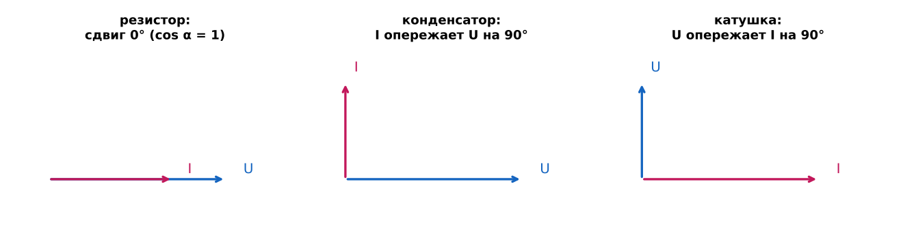

**Зачем этот график (📘 Л1, рис.3; 📗 «Основы», п.5.2).** Он объясняет, почему резистор греется, а конденсатор и катушка почти нет. У резистора ток и напряжение совпадают по фазе, и вся мощность активная (уходит в тепло). У конденсатора ток опережает напряжение на 90°, у катушки напряжение опережает ток на 90°: «в идеале у них нет активной мощности». Это понадобится на уровнях 4–5.

### 0.2. Базовые элементы — «алфавит» схемотехники

| Группа | Элемент | Что делает (одной фразой) | Где в источниках |
|---|---|---|---|
| Источники | источник напряжения (батарейка, аккумулятор), источник тока | дают энергию. Идеальный источник напряжения: R<sub>вн</sub> = 0; источник тока: R<sub>вн</sub> очень большое | 📘 Л1, рис.21 |
| Нагрузка | лампа, динамик, R<sub>н</sub>, «схема C1» | потребляет энергию | везде |
| Коммутация | ключ Кл | замыкает/размыкает цепь, даёт «0» и «1» | 📘 Л1, рис.4 |
| Пассивный | **резистор** | перераспределяет напряжения и токи, превращает энергию в тепло | 📘 Л2 |
| Реактивные | **конденсатор**, **катушка** | сначала запасают энергию, потом отдают; сопротивление зависит от частоты | 📘 Л1, Л3 |
| Две катушки | **трансформатор** | преобразует напряжение, ток и сопротивление, но не мощность | 📘 Л4 |
| Полупроводники | **диод** | пропускает ток в одном направлении (от анода к катоду) | 📘 Л5 |
| | **транзистор** | малым сигналом управляет большим током: ключ, переменный резистор, усилитель | 📘 Л1, 📗 «Транзисторы» |

**Почему именно такой порядок изучения (лестница уровней):**

```
источник + резистор + ключ   →  делитель, «0/1»                    (уровни 1, 3)
резистор + конденсатор       →  RC-цепь: время, фильтры             (уровень 4)
конденсатор + катушка        →  колебательный контур: частота       (уровень 5)
катушка + катушка            →  трансформатор                       (уровень 6)
p-n-переход ≈ «конденсатор»  →  диод (всегда в паре с резистором)   (уровень 7)
два p-n-перехода             →  транзистор = ключ / перем. резистор (уровень 8)
всё вместе                   →  выпрямитель, приёмник, усилитель    (уровень 9)
```

### 0.3. Кирпичики (паттерны), которые нужно научиться узнавать

| Код | Паттерн | Как узнать на схеме | Где впервые |
|---|---|---|---|
| **P1** | Делитель напряжения | два элемента последовательно, выход снимается со средней точки | Схема 1.4 |
| **P2** | Последовательный ограничитель (балласт) | элемент стоит последовательно с нагрузкой и «забирает лишнее» напряжение | Схема 3.2 |
| **P3** | Параллельный ограничитель с балластом | R<sub>б</sub> последовательно + нелинейный элемент (варистор, стабилитрон, диоды) параллельно выходу | Схема 3.6 |
| **P4** | Ключ в цепи нагрузки | ключ (или транзистор) последовательно с нагрузкой | Схема 1.3 |
| **P5** | Разделительный конденсатор | C последовательно между двумя частями схемы | Схема 4.3 |
| **P6** | Шунтирующий (фильтрующий) конденсатор | C параллельно чему-то: «закорачивает» переменную составляющую | Схема 4.4 |
| **P7** | RC-цепь времени | R заряжает или разряжает C | Схема 4.2 |
| **P8** | LC-контур | L и C вместе выбирают частоту | Схема 5.2 |
| **P9** | Датчик «величина → напряжение» | шунт, терморезистор, фоторезистор, диод в делителе | Схемы 3.3, 3.5 |
| **P10** | Отрицательная обратная связь | часть выхода возвращается на вход и гасит изменения | Уровень 9 |

---

## Уровень 1. Простейшие цепи: источник, резистор, ключ

На этом уровне нет «новых» элементов: только источник, резисторы и ключ. Нужно до автоматизма научиться видеть ток и напряжения, иначе всё остальное не сложится.

### Схема 1.1. Один резистор — закон Ома

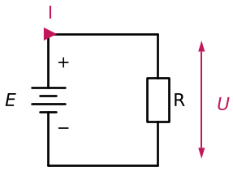

📗 «Основы», слайд 1, рис.3 · 📘 Л1

- **Что на схеме:** источник E и резистор R, замкнутый контур.
- **Путь тока:** от «+» источника через R к «−».
- **Что происходит:** всё напряжение источника приложено к резистору: U = E, ток I = U/R. Энергия превращается в тепло: P = U·I = I²R = U²/R.
- **Запомни:** при том же U больше R → меньше I (конспект «Основы», проверка здравого смысла).

### Схема 1.2. Два резистора последовательно

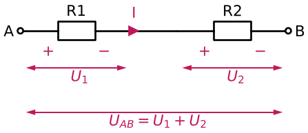

📗 «Основы», слайд 1, рис.1

- **Что происходит:** через R1 и R2 течёт **один и тот же ток** (ответвлений нет). Напряжения складываются: **U<sub>AB</sub> = U<sub>1</sub> + U<sub>2</sub>**.
- Полярность: ток входит в резистор со стороны «+».
- Сопротивления складываются: R<sub>экв</sub> = R1 + R2 (📘 Л1, рис.12).

### Схема 1.3. Ключ + резистор = логические «0» и «1»

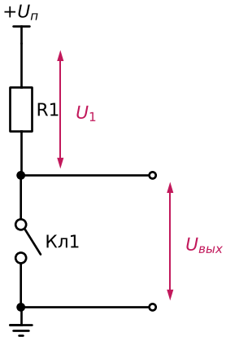

📘 Л1, рис.4 · 📗 «Основы», слайд 2, рис.4 — 🔁 **P4**

- **Всегда:** U<sub>п</sub> = U<sub>1</sub> + U<sub>вых</sub>.
- **Кл1 замкнут:** U<sub>1</sub> = U<sub>п</sub>, U<sub>вых</sub> = 0 → логический **«0»**.
- **Кл1 разомкнут:** тока нет, значит на R1 ничего не падает (U = I·R = 0): U<sub>1</sub> = 0, U<sub>вых</sub> = U<sub>п</sub> → логическая **«1»**.
- По лекции это **«базовая схема цифровой схемотехники»**: на ней строятся элементы «И», «НЕ», «ИЛИ».
- В лекции сразу говорится, что механический ключ можно заменить электронным реле или транзистором. Это сделаем в Схеме 8.1.

### Схема 1.4. Делитель напряжения

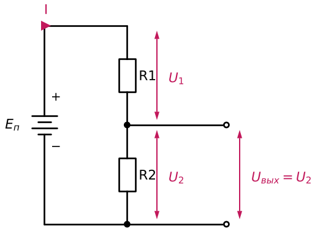

📘 Л1, рис.5 · 📗 «Основы», слайд 2, рис.5 — 🔁 **P1**

- **Формулы (со слайда):** I = E<sub>п</sub>/R, где R = R1 + R2; U<sub>1</sub> + U<sub>2</sub> = E<sub>п</sub>; U<sub>1</sub> = E<sub>п</sub> − U<sub>2</sub>; U<sub>2</sub> = E<sub>п</sub> − U<sub>1</sub>.
  Отсюда (📗 «Основы», п.2.5): **U<sub>2</sub> = E·R2/(R1+R2)**.
- **Два правила из лекции, которые работают во ВСЕХ схемах:**
  1. *Есть сумма и слагаемые.* E<sub>п</sub> = const, поэтому U<sub>1</sub>↑ → U<sub>2</sub>↓.
  2. *На большем падает большее.* На большем сопротивлении падает большее напряжение.
- **Запомни:** делитель не создаёт энергию и не усиливает, он берёт часть напряжения источника (📗 «Основы»).

### Схема 1.5. Параллельное и смешанное соединение

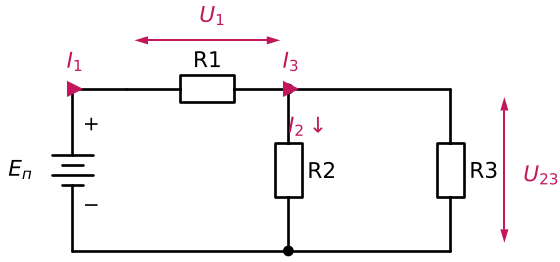

📘 Л1, рис.12–15 · 📗 «Основы», слайд 4

- **Параллельно:** одно и то же напряжение, токи делятся. 1/R<sub>э</sub> = 1/R1 + 1/R2; для двух: **R<sub>э</sub> = R1·R2/(R1+R2)**.
  Правило лекции: *если один резистор гораздо меньше остальных, общее сопротивление не больше его; минимальный резистор определяет примерное сопротивление всего участка.*
- **Смешанное (рис.13, на рисунке выше):**
  R<sub>э</sub> = R1 + R2‖R3 = R1 + R2·R3/(R2+R3) → I<sub>1</sub> = E<sub>п</sub>/R<sub>э</sub> → U<sub>1</sub> = I<sub>1</sub>·R1 → U<sub>23</sub> = E<sub>п</sub> − U<sub>1</sub> → I<sub>2</sub> = U<sub>23</sub>/R2, I<sub>3</sub> = U<sub>23</sub>/R3; проверка: I<sub>1</sub> = I<sub>2</sub> + I<sub>3</sub>.
- **Упрощение сложной цепочки (рис.14–15):** сворачиваем по группам: R<sub>123</sub> = R1+R2+R3; R<sub>45</sub> = R4R5/(R4+R5); R<sub>67</sub> = R6R7/(R6+R7); R<sub>1234567</sub> = R<sub>123</sub> + R<sub>45</sub> + R<sub>67</sub>.

### Схема 1.6. Законы Кирхгофа

| Источники согласно | Источники встречно (E1 > E2) |
|---|---|
|  | 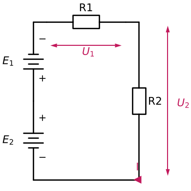 |

📘 Л1, рис.16 · 📗 «Основы», слайд 5, рис.15–16

- **1-й закон (узел):** ΣI = 0. Сколько втекло в узел, столько и вытекло (например, узел A: I<sub>1</sub> = I<sub>2</sub> + I<sub>3</sub>).
- **2-й закон (контур):** ΣU = 0.
  Согласно: **E<sub>1</sub> + E<sub>2</sub> = U<sub>1</sub> + U<sub>2</sub>**. Встречно (минус к минусу): **E<sub>1</sub> − E<sub>2</sub> = U<sub>1</sub> + U<sub>2</sub>**; нужно знать, какой источник больше.
- Если направление тока выбрали неверно, ответ просто выйдет со знаком минус (📗 «Основы», п.2.2).

### Схема 1.7. Реальный источник: внутреннее сопротивление

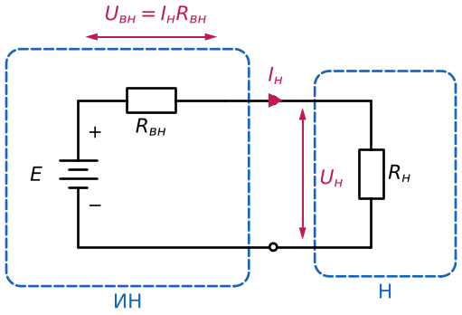

📘 Л1, рис.21 · 📗 «Основы», слайд 7

- Источник (ИН) = ЭДС E + внутреннее сопротивление R<sub>вн</sub>. С нагрузкой R<sub>н</sub> получается **делитель (P1)**: E = U<sub>вн</sub> + U<sub>н</sub> → **U<sub>н</sub> = E − R<sub>вн</sub>·I<sub>н</sub>**.
- R<sub>н</sub> меняется → меняется I<sub>н</sub> → меняется U<sub>н</sub>.

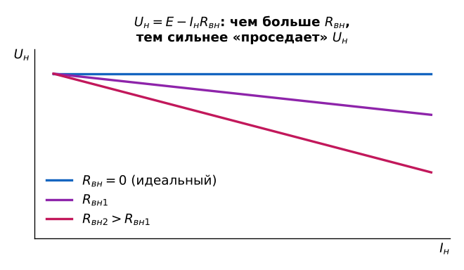

**Зачем этот график (слайд 7, рис.21):** он показывает, «проседает» ли источник под нагрузкой. При R<sub>вн</sub> = 0 линия горизонтальна (идеальный источник напряжения), и чем больше R<sub>вн</sub>, тем круче падает U<sub>н</sub>. Та же идея повторится у трансформатора (уровень 9, нагрузочная прямая) и у выходного сопротивления усилителя.

- **R<sub>вн</sub> ≪ R<sub>н</sub>** → **источник напряжения**: напряжение на нагрузке почти не падает.
- **R<sub>вн</sub> ≫ R<sub>н</sub>** → **источник тока**: он обеспечивает нагрузке заданный ток. Классический пример — зарядка аккумулятора. «Превратить источник напряжения в источник тока — воткнуть в цепь резистор с большим сопротивлением» (📘 Л1).

### Схема 1.8. «Усилитель» на переменном резисторе — идея усиления

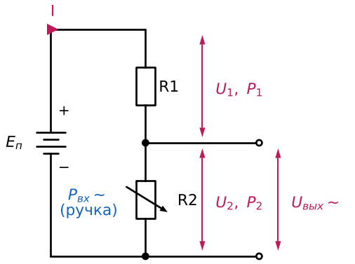

📘 Л1, рис.6 · 📗 «Основы», слайд 2, рис.6

- Это делитель (P1), в котором R2 — переменный. Рукой меняем R2 «по закону синуса» → по синусу меняется U<sub>2</sub> = U<sub>вых</sub>.
- Если резисторы небольшие, ток и мощности на них велики. Тогда **электрическая мощность на выходе больше механической мощности на входе**: P<sub>вх</sub> < P<sub>вых</sub>. Это и есть **обязательный признак усилителя**.
- Закон сохранения энергии не нарушается: усилитель **«отбирает» мощность у источника питания** (📘 Л1).
- Лекция сразу говорит: «это всё несерьёзно, должны быть элементы, которые будут этим управлять, например транзистор и электронная лампа». В Схеме 8.2 рука заменится транзистором.

### ❓ Проверь себя (уровень 1)

1. Почему в Схеме 1.3 при разомкнутом ключе на R1 нет напряжения?
2. Даны E<sub>п</sub> = 12 В, R1 = R2. Чему равен U<sub>2</sub>? Что станет с U<sub>2</sub>, если R1 увеличить?
3. Чем источник тока отличается от источника напряжения по R<sub>вн</sub>?
4. Откуда берётся «лишняя» мощность в Схеме 1.8?

<details><summary>Ответ</summary>

1. Ток не течёт, U = I·R = 0; всё напряжение оказывается на разомкнутых контактах, то есть на выходе.
2. 6 В. Если R1 увеличить, то U<sub>1</sub>↑ («на большем падает большее»), а U<sub>2</sub>↓, потому что сумма постоянна.
3. У источника напряжения R<sub>вн</sub> ≪ R<sub>н</sub> (идеал — 0), у источника тока R<sub>вн</sub> ≫ R<sub>н</sub>.
4. Из источника питания: вход только управляет тем, как энергия источника передаётся на выход.

</details>

---

## Уровень 2. Переменный сигнал — язык графиков

**Зачем этот уровень:** конденсаторы, катушки, трансформаторы, выпрямители и усилители работают с переменным сигналом. Все их графики построены на параметрах ниже, поэтому без них не прочитать ни одну характеристику дальше. Новых элементов здесь нет, только графики (📘 Л1, рис.17–22; 📗 «Основы», слайды 6 и 8).

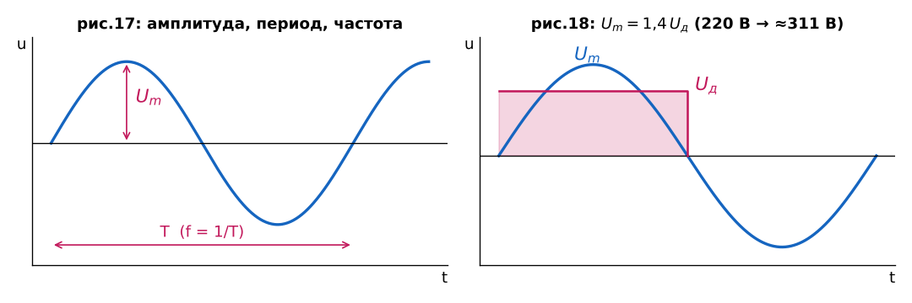

- **Рис.17:** амплитуда U<sub>m</sub>, период T, частота **f = 1/T**.
- **Рис.18 — действующее значение U<sub>д</sub>.** В лекции: «берём площадь полуволны, строим равный по площади прямоугольник, его высота — U<sub>д</sub>». В конспекте: это такое постоянное напряжение, которое выделило бы на резисторе столько же тепла. Связь: **U<sub>m</sub> = 1,4·U<sub>д</sub>** (U<sub>д</sub> = U<sub>m</sub>/√2). Приборы показывают действующее значение (📘 Л4). Поэтому «220 В в розетке» — это действующее значение, а пик ≈ 311 В. Детали выбирают по пику: диоды (уровень 7), конденсаторы.

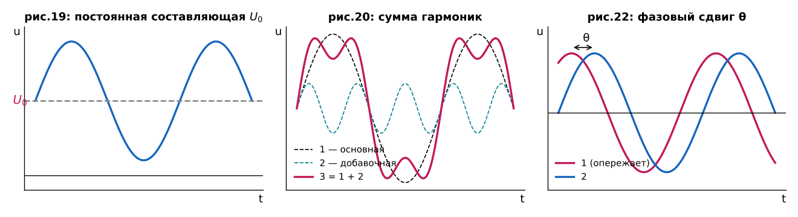

- **Рис.19 — постоянная составляющая U<sub>0</sub>:** график сдвинут относительно нуля. В усилителе так выглядит сигнал на транзисторе: постоянный режим плюс полезная переменная часть (📗 «Основы», п.4.3). Убирать U<sub>0</sub> будет разделительный конденсатор (Схема 4.3).
- **Рис.20 — гармоники:** сигнал любой формы можно получить сложением гармонических сигналов разной частоты и амплитуды; на рисунке сигнал 3 = гармоника 1 + гармоника 2. В усилителе искажения проявляются как лишние гармоники, их меряет коэффициент гармоник K<sub>г</sub> (уровень 9).
- **Рис.22 — фазовый сдвиг θ:** сигнал 1 опережает сигнал 2 на угол θ. В лекции пример: сигналу нужно время, чтобы пройти через цепи усилителя, поэтому между входом и выходом всегда есть разность фаз.

### ❓ Проверь себя (уровень 2)

1. Вольтметр показал 24 В переменного. Какова амплитуда?
2. Чем сигнал рис.19 отличается от рис.17 и какой элемент может «убрать» это отличие?

<details><summary>Ответ</summary>

1. U<sub>m</sub> = 1,4·24 ≈ 34 В (тот же пример есть на слайде «Трансформаторы», 2).
2. У него есть постоянная составляющая U<sub>0</sub>; её не пропускает разделительный конденсатор (Схема 4.3).

</details>

---


## Уровень 3. Резистор

### 3.0. Что такое резистор и зачем он нужен

**Определение (📘 Л2):** резисторы — пассивные элементы радиоэлектронной аппаратуры для создания в электрических цепях требуемых величин сопротивлений, обеспечивающих **заданное перераспределение и регулирование электрической энергии** между элементами схемы.

Резистор не создаёт энергию и не усиливает. Он **перераспределяет** её, а часть превращает в тепло (📗 «Резисторы», п.1.1–1.3). В лекции два подхода:

**Перераспределение напряжений:** от одного источника E<sub>п</sub> каждый делитель (R1–R2, R3–R4, R5–R6) создаёт своё напряжение для своего узла C1, C2, C3.

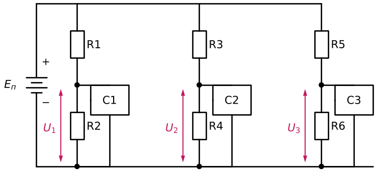

**Перераспределение токов:** последовательные резисторы задают узлам разные токи I<sub>1</sub>, I<sub>2</sub>, I<sub>3</sub> (например, лампы будут гореть по-разному).

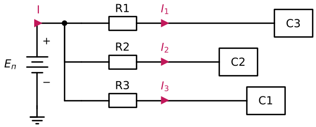

📘 Л2, рис.1–2 · 📗 «Резисторы», слайд 1, рис.1

Дальше — три простейшие «резисторные» схемы (делитель, ограничитель, датчик тока) и их варианты.

### Схема 3.1. Делитель напряжения с нагрузкой и его расчёт

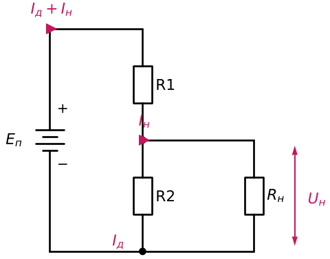

📘 Л2, «Применение резисторов», п.1 · 📗 «Резисторы», слайд 2, рис.2 — 🔁 **P1**

- **Главная проблема:** нагрузка R<sub>н</sub> подключается **параллельно R2**, поэтому нижнее плечо становится R2‖R<sub>н</sub> (📗 «Резисторы», п.2.2), и напряжение уходит от расчётного. Чтобы этого не было, **ток делителя берут больше тока нагрузки: I<sub>д</sub> ≥ (3…5)·I<sub>н</sub>**. Тогда (I<sub>д</sub> + I<sub>н</sub>) ≈ I<sub>д</sub>.
- **Цена:** чем больше ток делителя, тем больше мощности рассеивают резисторы. От сети это некритично, а от батареи приходится экономить (📘 Л2).
- **Алгоритм со слайда:**
  1. выбрать I<sub>д</sub>;
  2. R<sub>д</sub> = R1 + R2 = E<sub>п</sub>/I<sub>д</sub>;
  3. K = U<sub>вых</sub>/U<sub>вх</sub> = U<sub>н</sub>/E<sub>п</sub> (коэффициент передачи делителя);
  4. R1 = R<sub>д</sub>·(1 − K), R2 = R<sub>д</sub>·K;
  5. P1 = I<sub>д</sub>·E<sub>п</sub>·(1 − K), P2 = I<sub>д</sub>·E<sub>п</sub>·K. Оба резистора берут на одну мощность: P1 = P2 = max(P1, P2). P1 может не равняться P2, «но к этому стремятся» (📘 Л2).

**Пример из лекции (рис.3) — делитель задаёт режим транзистора.** Здесь транзистор — просто нагрузка, которая потребляет ток базы I<sub>б</sub>; сам транзистор разберём на уровне 8.

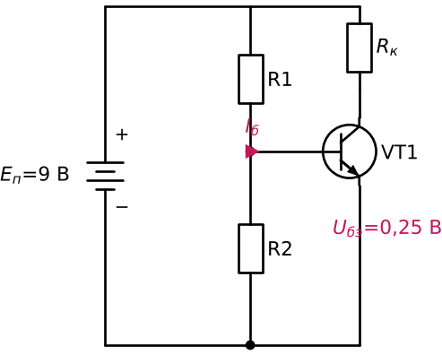

| Шаг | Расчёт (📗 «Резисторы», слайд 3, рис.3) |
|---|---|
| Дано | E<sub>п</sub> = 9 В, U<sub>бэ</sub> = 0,25 В, I<sub>б</sub> = 0,02 мА |
| 1 | I<sub>д</sub> = 5·I<sub>б</sub> = 0,1 мА |
| 2 | R<sub>д</sub> = 9 В / 0,1 мА = 90 кОм |
| 3 | K = 0,25/9 = 0,028 |
| 4 | R1 = 90·(1 − 0,028) ≈ 87,5 кОм; R2 = 90·0,028 ≈ 2,5 кОм |
| 5 | P1 = 0,1 мА·9 В·0,972 ≈ 0,87·10⁻³ Вт; P2 ≈ 2,52·10⁻⁵ Вт → выбираем P1 = P2 = 0,125 Вт |

⚠️ В тексте конспекта «Резисторы» (п.3.3) этот пример пересчитан с другими числами (I<sub>н</sub> ≈ 0,2 мА, I<sub>д</sub> = 1 мА, R<sub>д</sub> = 9 кОм). В лекции и на слайде I<sub>б</sub> = 0,02 мА — следуйте им. Метод одинаковый.

### Схема 3.2. Ограничитель тока (светодиод)

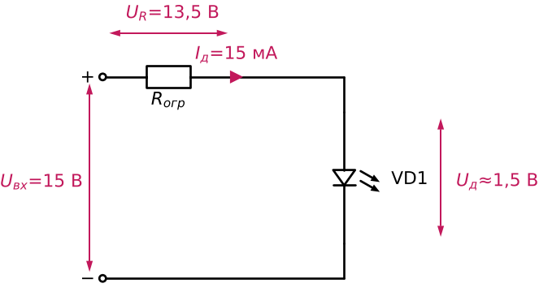

📘 Л2, «Применение», п.2 · 📗 «Резисторы», слайд 3, рис.4 — 🔁 **P2**

- Резистор R<sub>огр</sub> стоит **последовательно** с нагрузкой и забирает «лишнее» напряжение.
- **Без него** включать светодиод опасно: он может выйти из строя (📘 Л2). Конспект поясняет: у светодиода маленькое увеличение напряжения даёт большой рост тока.
- **Расчёт со слайда:** U<sub>вх</sub> = 15 В, U<sub>д</sub> ≤ 2 В (берём 1,5 В), I<sub>д</sub> = 5…20 мА (берём 15 мА):
  R<sub>огр</sub> = (15 − 1,5) В / 15 мА = **900 Ом**; P<sub>огр</sub> = 13,5 В · 15 мА ≈ 0,2 Вт → берём с запасом **0,25 Вт**.
  ⚠️ В конспекте написано «например 0,5 Вт». Обе цифры с запасом; на слайде выбрано 0,25 Вт.

### Схема 3.3. Резистор — датчик тока

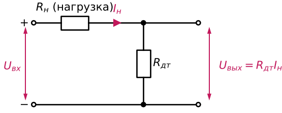

📘 Л2, «Применение», п.3 · 📗 «Резисторы», слайд 3, рис.5 — 🔁 **P9**

- В цепь нагрузки последовательно ставят маленький резистор R<sub>дт</sub>. Ток нагрузки создаёт на нём напряжение: **U<sub>вых</sub> = R<sub>дт</sub>·I<sub>н</sub>** → по нему ведём учёт тока.
- **Условие: R<sub>дт</sub> ≪ R<sub>н</sub>.** Шунт не должен мешать нагрузке, но и не может быть нулевым, иначе не будет измеряемого напряжения. Проверяют его мощность P = I²R (📗 «Резисторы», п.2.4).

### Схема 3.4. Переменный резистор: потенциометр и реостат

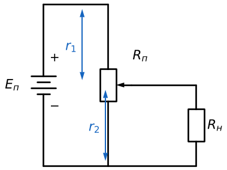

📘 Л2, рис.18 · 📗 «Резисторы», слайд 7, рис.18

- **Делитель из одного резистора.** Движок делит резистивный элемент на r<sub>1</sub> и r<sub>2</sub>: r<sub>1</sub> — аналог R1, r<sub>2</sub> — аналог R2 из Схемы 1.4 (📘 Л2).

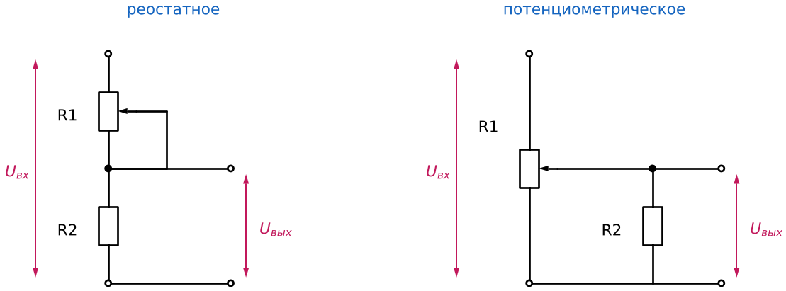

📘 Л2, рис.19 · 📗 «Резисторы», слайд 8

- **Реостатное включение** (слева): R1 работает как регулируемое последовательное сопротивление. **Потенциометрическое** (справа): R1 делит напряжение движком. Оба дают **делитель с переменным коэффициентом передачи** (📘 Л2).
- Конспект добавляет: реостат регулирует ток, потенциометр — напряжение. Деталь одна и та же, различается способ подключения.

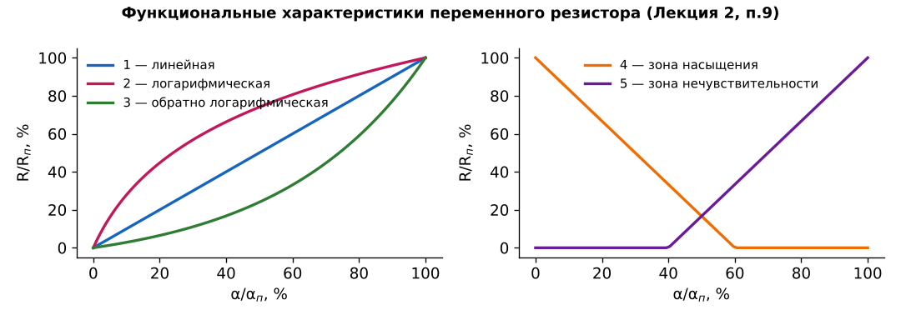

**Зачем этот график (📘 Л2, параметр 9; 📗 «Резисторы», слайд 4, рис.8 п.9).** По оси Y — R/R<sub>п</sub>, по оси X — относительный угол поворота α/α<sub>п</sub>. График показывает, как сопротивление меняется при повороте ручки:
1 — линейная; 2 — логарифмическая; 3 — обратная логарифмическая; 4 — **зона насыщения** (с какого-то момента сопротивление не меняется); 5 — **зона нечувствительности** (сопротивление не появляется до какого-то момента). Логарифмическая удобна для регулятора громкости, потому что слух воспринимает громкость примерно логарифмически (📗 «Резисторы», п.7.3).

### Полупроводниковые резисторы: тот же делитель, но R зависит от внешней величины

### Схема 3.5. Терморезистор в делителе

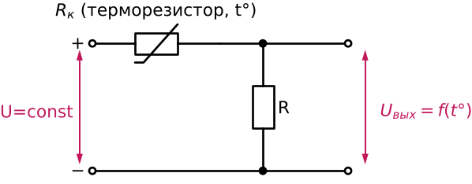

📘 Л2, «Применение», п.4 · 📗 «Резисторы», слайд 3, рис.6 — 🔁 **P1 + P9**

- На входе постоянное напряжение, тогда **выход — функция температуры**: U<sub>вых</sub> = f(t°).
- **Цепочка из лекции:** t°↑ → R<sub>к</sub>↓ → (по правилу «на большем падает большее» на R<sub>к</sub> падает меньше) → **U<sub>вых</sub>↑**.
- Данные терморезисторов (📘 Л2; слайд 7, рис.16): маркировка ММТ, КМТ (старая), СТ1/СТ2/СТ3 (новая); R = 1 Ом…4,3 МОм; допуск 10–30 %; t = −60…+300 °C; ТКС α = 2,2…7 %/°C; постоянная времени T = 1…115 с.
- 💡 Этот же приём (терморезистор в делителе) спасёт транзисторный усилитель от перегрева (уровень 9, H15, шаг 1).
- **Фоторезистор** работает так же, только от света. Лекция даёт характеристики (рис.17): области спектра ВО/УФ/ИК (CdS, CdSe, PbS), I<sub>св</sub> = 20…3000 мкА, I<sub>т</sub> = 0,01…100 мкА, R<sub>т</sub> = 20 кОм…10 МОм, T = 2…200 мс. В делителе даёт напряжение, зависящее от освещённости (📗 «Резисторы», п.4.2).

### Схема 3.6. Варистор — ограничитель напряжения

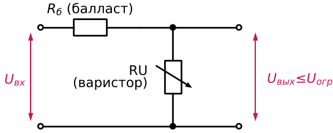

📘 Л2, «Применение», п.5 · 📗 «Резисторы», слайд 3, рис.7 — 🔁 **P3**

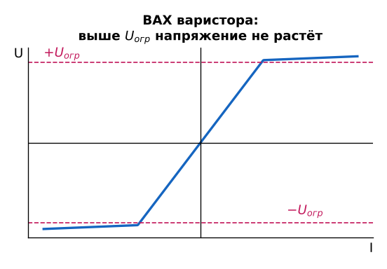

**Зачем этот график (рис.7).** ВАХ варистора нелинейна: пока |U| < U<sub>огр</sub>, напряжение растёт вместе с током, а дальше почти не растёт. Поэтому выходное напряжение **не превысит U<sub>огр</sub>**, и его можно использовать как стабилизатор. **Избыточное напряжение падает на балластном R<sub>б</sub>** (📘 Л2).

💡 Запомните структуру «R<sub>б</sub> последовательно + нелинейный элемент параллельно выходу» (P3). Ровно так же устроены стабилизатор на стабилитроне (Схема 7.10) и все диодные ограничители (Схемы 7.3, 7.12).

### 3.7. Как выбрать резистор: рабочие напряжение и ток

📘 Л2 · 📗 «Резисторы», слайд 8, рис.19

- U<sub>раб</sub> ≤ √(P<sub>рас.ном</sub>·R<sub>ном</sub>) **и** U<sub>раб</sub> ≤ U<sub>доп</sub> (U<sub>пред</sub>).
- I<sub>раб</sub> ≤ √(P<sub>рас.ном</sub>/R<sub>ном</sub>) **и** I<sub>раб</sub> ≤ U<sub>доп</sub>/R<sub>ном</sub>.
- Реальный предел — **более строгое** из двух условий (📗 «Резисторы», п.8.1). Примеры со слайда:
  - 2 Вт, 2 Ом, U<sub>доп</sub> = 250 В: U<sub>раб</sub> ≤ √(2·2) = **2 В** (ограничивает мощность);
  - 2 Вт, 2 МОм, U<sub>доп</sub> = 500 В: по мощности I ≤ √(2/2·10⁶) = 1 мА, по напряжению I ≤ 500/2·10⁶ = **0,25 мА** (ограничивает напряжение).

<details><summary>Справка к экзамену: параметры, маркировка, классификация резисторов (📘 Л2, слайды 4–6)</summary>

| № | Параметр | Коротко |
|---|---|---|
| 1 | R<sub>н</sub> — номинал | из рядов E6, E12, E24, E48, E96, E192 (цифра — число значений в ряду). E6: 1,0; 1,5; 2,2; 3,3; 4,7; 6,8 |
| 2 | Допуск δ | ±0,001…±30 %; буквами: F — 1 %, I — 5 %, K — 10 % |
| 3 | P<sub>ном</sub> (P<sub>рас</sub>) | мощность, которую резистор рассеивает в течение гарантированного времени работы |
| 4 | U<sub>пред</sub> | максимальное напряжение на резисторе |
| 5 | ТКС | α = ΔR/(R<sub>0</sub>·ΔT), 1…2000·10⁻⁶ 1/°C |
| 6 | Коэффициент напряжения | K<sub>u</sub> = (R<sub>10</sub> − R<sub>100</sub>)/R<sub>10</sub>·100 % (R при напряжении, соответствующем 10 % и 100 % номинальной мощности) |
| 7 | Шумы | E<sub>ш</sub> = E<sub>т</sub> + E<sub>и</sub> (тепловые + токовые) |
| 8 | Паразитные L<sub>c</sub>, C<sub>c</sub> | эквивалентные схемы со слайда; у проволочных — «большие значения реактивных параметров» |
| 9–12 | для переменных | функциональная характеристика; R<sub>min</sub> (разрешающая способность) 0,1…3 %; шумы скольжения E<sub>шс</sub> 15…50 мВ; разбаланс сдвоенных ≤ 3 дБ |

- **Обозначение на схеме:** Ом: E, R, Ω; 1 Ом = 1E = 1R; 0,5 Ом = E5 = R5; 1,2 Ом = 1E2 = 1R2; 2,4 кОм = 2к4; 0,2 МОм = М2. Мощность — штрихами в корпусе: 0,05 / 0,125 / 0,25 / 0,5 / 1 / 5 Вт (слайд 5, рис.10).
- **Маркировка:** МЛТ-0,25-300 Ом ±10 % (М — металлоплёночный, Л — лакированный, Т — теплостойкий); С4 — постоянный непроволочный композиционный объёмный, СП — переменный; Р1-4-0,5-10 кОм ±1 % А-Б-В (Р — постоянный, РП — переменный, НР — набор; 1 — непроволочный, 2 — проволочный; А — группа по шумам, Б — по ТКС, В — исполнение); варистор СН1-2-1-270 ±10 % Т (СН — сопротивление нелинейное, карбид кремния; 2 — дисковая конструкция; 270 — уровень ограничения; Т — тропическое исполнение).
- **Классификация (слайд 6, рис.15):** назначение — ОН (1 Ом…10 МОм, 0,05…100 Вт, 1…30 %) и специальные (высокоомные до 10¹¹ Ом, высоковольтные, высокочастотные с малыми C<sub>c</sub>, L<sub>c</sub>, прецизионные 0,001…0,5 %); защита — неизолированные (НР) / изолированные (ИР); материал — проволочные (стабильные, малошумящие, мощные, точные, но с большой паразитной индуктивностью) / непроволочные; ВАХ — линейная / нелинейная (варисторы).

</details>

### ❓ Проверь себя (уровень 3)

1. Почему ток делителя берут в 3–5 раз больше тока нагрузки? Чем за это платим?
2. Что будет со светодиодом в Схеме 3.2 без R<sub>огр</sub>?
3. Почему шунт R<sub>дт</sub> должен быть много меньше R<sub>н</sub>, но не нулевым?
4. Что общего у варистора (Схема 3.6) и делителя (Схема 1.4)?

<details><summary>Ответ</summary>

1. Нагрузка подключена параллельно R2 и меняет нижнее плечо (R2‖R<sub>н</sub>). Если I<sub>д</sub> ≫ I<sub>н</sub>, влияние мало. Платим мощностью потерь на резисторах, что критично при питании от батареи.
2. Ток ничем не ограничен, и светодиод может выйти из строя.
3. Чтобы почти не влиять на ток нагрузки. При нулевом сопротивлении U = I·0 = 0, измерять нечего.
4. Это тоже делитель: R<sub>б</sub> сверху, варистор снизу. Только нижнее плечо нелинейное: при росте напряжения его сопротивление падает, и «лишнее» уходит на R<sub>б</sub>.

</details>

---

## Уровень 4. Конденсатор

### 4.0. Устройство и главные формулы

📘 Л3, рис.1–2 · 📗 «Конденсаторы», слайд 1

- Конденсатор — две металлические пластины (обкладки) и слой диэлектрика (рис.1).
- **C = ε<sub>0</sub>·ε·S/r** (S — площадь перекрытия, r — расстояние между пластинами, ε — проницаемость диэлектрика); **X<sub>c</sub> = 1/(2πfC)**; энергия **W<sub>c</sub> = C·U²/2** (рис.2).
- Пример (📘 Л1, рис.23): C = 1 мкФ, f = 1 кГц → X<sub>c</sub> = 1/(2π·10³·10⁻⁶) = **159 Ом**.
- Конденсатор **реактивный**: сначала запасает энергию, потом отдаёт (📘 Л1). Ток опережает напряжение на 90° (график g01 выше).
- Постоянный ток: «конденсатор единожды заряжается и после этого ток не пропускает». Переменный: циклично заряжается и разряжается, то есть «пропускает ток всё время» (📘 Л3). Чем выше f, тем меньше X<sub>c</sub>.

### Схема 4.1. Заряд от источника тока

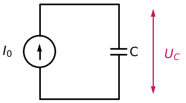

📘 Л3, рис.3 · 📗 «Конденсаторы», слайд 1, рис.3

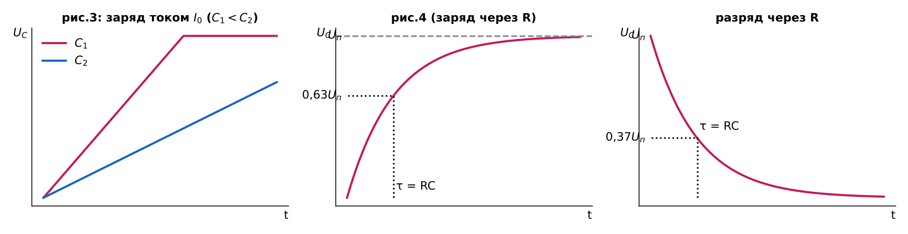

**Зачем эти графики (📘 Л3, рис.3–4; 📗 «Конденсаторы», слайд 1–2).**
- **Левый (рис.3):** если через конденсатор идёт **постоянный ток I<sub>0</sub>**, напряжение растёт **линейно** до определённого уровня. **Чем больше ёмкость, тем медленнее заряжается** (C<sub>1</sub> < C<sub>2</sub>). Формула из конспекта: ΔU = I·Δt/C.
- Средний и правый — к следующей схеме.

### Схема 4.2. Заряд через резистор и разряд — RC-цепь

| Заряд | Разряд |
|---|---|
| 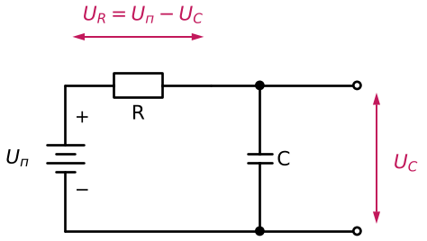 | 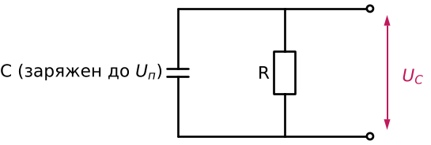 |

📘 Л3, рис.4 · 📗 «Конденсаторы», слайд 1, рис.3–4 — 🔁 **P7**

- **Заряд:** U<sub>R</sub> = U<sub>п</sub> − U<sub>C</sub>. По мере зарядки U<sub>C</sub> растёт, на R остаётся всё меньше, ток падает, и рост замедляется. Поэтому кривая **экспоненциальная** (📘 Л3).
- **Постоянная времени T = R·C:** за T заряд доходит до **0,63·U<sub>п</sub>**, разряд — до **0,37·U<sub>п</sub>** (графики выше, средний и правый).
- Конспект добавляет: после ≈5τ конденсатор практически заряжен; U<sub>зар</sub>(t) = U<sub>0</sub>(1 − e<sup>−t/RC</sup>), U<sub>разр</sub>(t) = U<sub>0</sub>·e<sup>−t/RC</sup>.
- 💡 Где пригодится: формирование интервалов времени (уровень 9, H8), генераторы (H9).

### Схема 4.3. Разделительный конденсатор

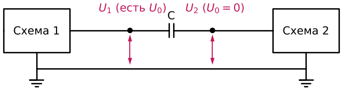

📘 Л3, рис.5 · 📗 «Конденсаторы», слайд 2, рис.5 — 🔁 **P5**

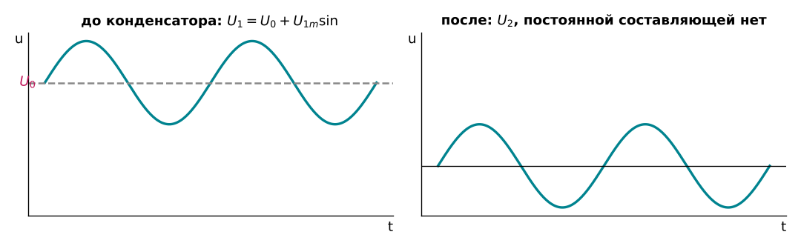

**Зачем этот график (рис.5).** Две схемы соединены конденсатором. На выходе схемы 1 есть постоянная составляющая U<sub>0</sub> (как на рис.19 уровня 2). Конденсатор **не пропускает (убирает) постоянную составляющую**: он заряжается от неё один раз и дальше тока не пропускает. **Переменная составляющая проходит**: в положительном полупериоде конденсатор заряжается, в отрицательном разряжается. После конденсатора U<sub>0</sub> = 0 (📘 Л3).

💡 В усилителе (уровень 9) такие конденсаторы стоят на входе (C<sub>б</sub>) и на выходе (C<sub>р</sub>). Они не дают постоянным режимам каскадов «смешаться» (📗 «Конденсаторы», п.4.1).

### Схема 4.4. RC-фильтры: частотно-зависимые делители

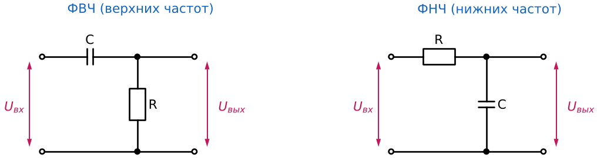

📘 Л3, рис.7 · 📗 «Конденсаторы», слайд 2, рис.7 — 🔁 **P1 + P6**

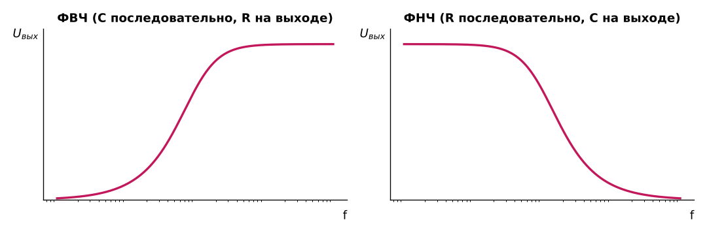

**Зачем эти графики.** Это тот же **делитель (P1)**, но одно из плеч — конденсатор, его сопротивление зависит от частоты. Поэтому коэффициент передачи — функция частоты. Амплитуда на входе постоянна, меняется только частота.
- **ФВЧ** (C последовательно, выход с R): на низких частотах X<sub>c</sub> очень велико, всё напряжение падает на конденсаторе, на R почти ноль. С ростом f X<sub>c</sub> падает, и U<sub>вых</sub> растёт до определённого уровня. Пропускает высокие частоты.
- **ФНЧ** (R последовательно, выход с C): с ростом f X<sub>c</sub> падает, напряжение перераспределяется на R, и U<sub>вых</sub> уменьшается. Пропускает низкие частоты (📘 Л3).
- Частота среза f<sub>с</sub> ≈ 1/(2πRC) (📗 «Конденсаторы», п.4.3).

### Схема 4.5. Сопротивление «по постоянному» и «по переменному» току

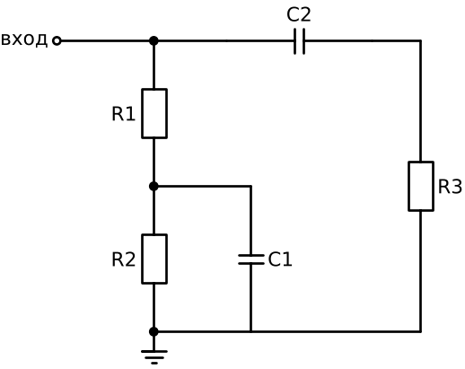

📘 Л3, рис.6 · 📗 «Конденсаторы», слайд 2, рис.6

Это **главный навык для гибридных схем**: одну и ту же схему рассматривают дважды.
- **По постоянному току** конденсатор — разрыв. C2 отсекает R3, C1 не влияет: **R<sub>=</sub> = R1 + R2**.
- **По переменному току** реактивные сопротивления конденсаторов считаются равными 0 (X<sub>c1</sub>, X<sub>c2</sub> ≪ R): C1 замыкает R2, C2 подключает R3 к входу: **R<sub>≈</sub> = R1‖R3** (📘 Л3).

💡 На уровне 9 вы так разберёте каждый усилительный каскад: по постоянному току ищем режим транзистора, по переменному — путь сигнала.

### Схема 4.6. Емкостный делитель и ограничитель тока

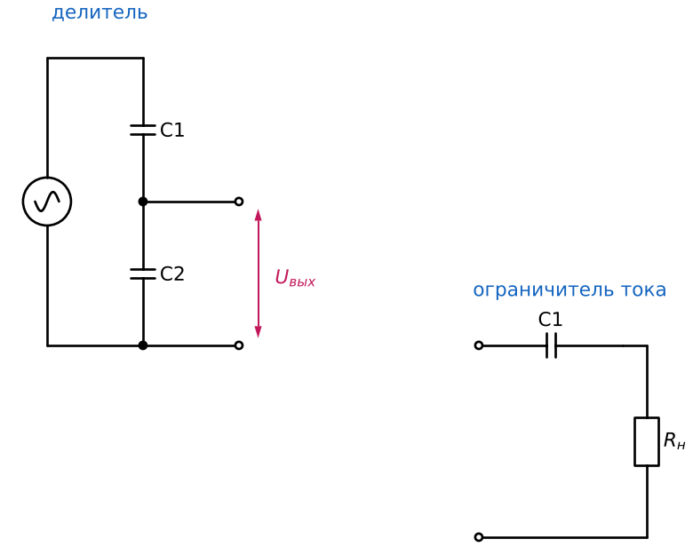

📘 Л3, рис.11 · 📗 «Конденсаторы», слайд 3, рис.11

- Работают так же, как резисторные (Схемы 1.4 и 3.2), **но только на переменном токе и не нагреваются** (📘 Л3). Конденсатор почти не рассеивает активную мощность (g01).

### Схема 4.7. Гальваническая развязка конденсатором

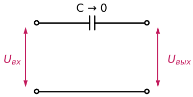

📘 Л3, рис.13 · 📗 «Конденсаторы», слайд 3, рис.13

- Конденсатор с очень малой ёмкостью (C → 0) пропускает только высокочастотные сигналы, а низкочастотные нет: X<sub>c</sub> = 1/(2πfC) мало только при большом f.
- **Применение из лекции:** осветительные провода как антенна радиоприёмника. Ток сети 50 Гц задерживается конденсатором и не вредит приёмнику, а радиоволны проходят.

### 4.8. Соединение конденсаторов

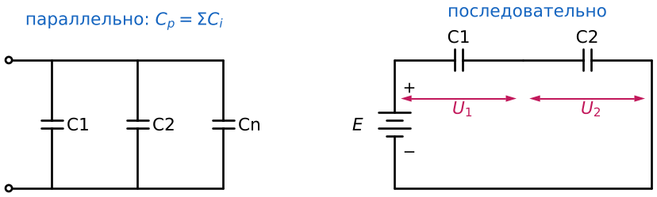

📘 Л3, п.18–21 · 📗 «Конденсаторы», слайд 6, рис.21

- **Параллельно:** C<sub>p</sub> = ΣC<sub>i</sub>; рабочее напряжение группы — **наименьшее** из рабочих: U<sub>p</sub> = U<sub>min</sub>.
- **Последовательно:** 1/C<sub>p</sub> = Σ(1/C<sub>i</sub>). Напряжения распределяются **обратно ёмкостям**: U<sub>2</sub>/U<sub>1</sub> = C<sub>1</sub>/C<sub>2</sub>; U<sub>1</sub> = E·C<sub>2</sub>/(C<sub>1</sub>+C<sub>2</sub>); U<sub>2</sub> = E·C<sub>1</sub>/(C<sub>1</sub>+C<sub>2</sub>).
  Пример: E = 30 В, C<sub>1</sub> = 0,1 мкФ, C<sub>2</sub> = 0,2 мкФ → U<sub>1</sub> = 20 В, U<sub>2</sub> = 10 В (на меньшей ёмкости больше напряжения).
- **Рабочее напряжение цепочки** (рис.21): C<sub>1</sub> = 1 мкФ × 25 В, C<sub>2</sub> = 10 мкФ × 25 В. Меньшая ёмкость зарядится быстрее, поэтому её доводим до предела: U<sub>1</sub> = 25 В, U<sub>2</sub> = U<sub>1</sub>·C<sub>1</sub>/C<sub>2</sub> = 2,5 В → **U<sub>p</sub> = 27,5 В** (а не 50 В!).

### 4.9. Где применяются конденсаторы (список из 📘 Л3)

1. разделение постоянной и переменной составляющих (Схема 4.3);
2. частотно-зависимые делители — фильтры (Схема 4.4);
3. подавление пульсаций в выпрямителе → уровень 9, H6;
4. задание интервалов времени → уровень 9, H8;
5. генератор сигнала с ЧЗПОС → уровень 9, H9;
6. емкостные делитель и ограничитель тока (Схема 4.6);
7. датчики: C = φ(α) (угол поворота ротора), C = φ(L) (расстояние между обкладками), C = φ(t°), граница двух сред: чем глубже погружён в топливо (ε<sub>2</sub>), тем больше C<sub>x</sub> = C<sub>1</sub> + C<sub>2</sub> (рис.12);
8. гальваническая развязка (Схема 4.7).

### 4.10. Допустимая амплитуда переменного напряжения (график-«карта»)

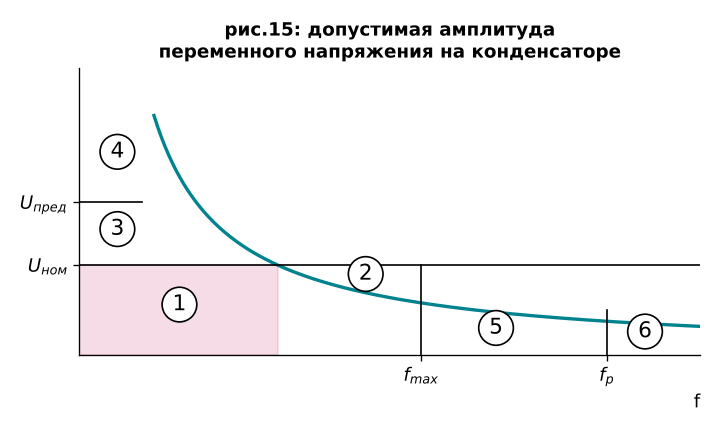

**Зачем этот график (📘 Л3, параметр 8; 📗 «Конденсаторы», слайд 5, рис.15).** Он показывает, при каких амплитуде и частоте конденсатор работает правильно, а при каких разрушается. Области:
1 — рабочая; 2 — тепловой пробой; 3 — повышенная вероятность электрического пробоя; 4 — электрический пробой; 5 — пониженное значение ёмкости; 6 — индуктивное сопротивление (конденсатор перестаёт быть емкостным).
С ростом частоты меняются ε, собственная индуктивность и tg δ. На резонансной частоте f<sub>р</sub> ёмкость «становится нулевой» и конденсатор ведёт себя как индуктивность. Поэтому **f<sub>max</sub> = f<sub>р</sub>/(2…3)** (📘 Л3, параметр 7).

<details><summary>Справка к экзамену: параметры, маркировка, классификация конденсаторов (📘 Л3, слайды 4–7)</summary>

1. **Удельная ёмкость** C<sub>уд</sub> = C/m (или C/V).
2. **Номинал**: ряды E3 (1,0; 2,2; 4,7), E6 … E192. Обозначения: p — 10⁻¹² Ф, n — 10⁻⁹, μ — 10⁻⁶, m — 10⁻³, F — 1 Ф; буква на месте запятой: P10 = 0,1 пФ, 2p2 = 2,2 пФ, 1μ2 = 1,2 мкФ.
3. **Допуск** 0,001…100 %: ±1 % F(Р), ±10 % K(С), ±30 % N(Ф), −10…+50 % T(Э), −20…+50 % S(Б), −20…+80 % Z(А), +100 % —(Я); в пикофарадах: ±0,1 пФ B, ±0,25 пФ C, ±0,5 пФ D, ±1 пФ F.
4. **U<sub>ном</sub>**: при росте t° U<sub>ном</sub> снижают. При 10–15 % от U<sub>ном</sub> утечка минимальна, при 80–90 % заметнее. Превышение ускоряет деградацию и повышает вероятность пробоя. Вывод лекции: **«конденсатор надо использовать, не догружая»**.
5. **tg δ = P<sub>а</sub>/P<sub>р</sub>** (дополнение угла сдвига до 90°): у керамических 0,001…0,01, некоторые электролитические в этот диапазон не попадают (на слайде второй диапазон — 0,1…0,3), зато у них высокая удельная ёмкость; t°↑ → tg δ↑; tg δ = φ(f); добротность **Q = 1/tg δ**.
6. **R<sub>из</sub> = U/I<sub>ут</sub>** (ток утечки — скорость саморазряда).
7. **Собственная L и R** (эквивалентные схемы L<sub>c</sub> + R<sub>п</sub> + C); C = φ(f); f<sub>max</sub> = f<sub>р</sub>/(2…3).
8. **Допустимая амплитуда** — график выше.
9. **ТКЕ** 10⁻²…10⁻⁶ 1/°C: М — минус, П — плюс, МП — близок к нулю, Н — ненормируемый (П100 → +100·10⁻⁶; М750 → −750·10⁻⁶; Н20 → ±20 % от C при +20 °C; коды: П100 — A, М33 — H, Н20 — Z, Н90 — F).
10. **КТНЕ**; 11. **шумы** (акустические и электрические: частичные разряды, мерцание ёмкости, пьезоэффект); 12. **диэлектрическая абсорбция** K<sub>a</sub> = U<sub>2</sub>/U<sub>1</sub>·100 % (заряд до U<sub>1</sub>, КЗ 5 с, через 3 мин измеряют U<sub>2</sub>).
- **Классификация (рис.17):** ОН/СН; постоянной/переменной/подстроечной ёмкости; по защите — незащищённые (Н.К.), защищённые (З.К.), неизолированные (Н.К.), изолированные (И.К.), герметизированные (Г.К.); диэлектрик органический, неорганический, газообразный, активный.
- **Обозначения (рис.20):** К — постоянной ёмкости, КП — переменной, КН — вариконд (нелинейный), КС — сборка; К10-8 — керамический, разработка 8; К75-10-250 В-0,47 мкФ ±5 %-В.
- **Переменная ёмкость (рис.18):** C = ε<sub>0</sub>εS/r → меняют ε, S или r; C<sub>max</sub>, C<sub>min</sub>, K<sub>c</sub> = C<sub>max</sub>/C<sub>min</sub>; закон C = φ(α); у вариконда ε = φ(U) — схема на уровне 9, H1.

</details>

### ❓ Проверь себя (уровень 4)

1. Чему равна постоянная времени RC-цепи и до какой доли U<sub>п</sub> заряжается конденсатор за это время?
2. Почему после разделительного конденсатора нет постоянной составляющей?
3. Нарисуйте Схему 4.5 «по постоянному» и «по переменному» току.
4. Два конденсатора по 25 В (1 мкФ и 10 мкФ) соединили последовательно. Можно ли подать на них 50 В?

<details><summary>Ответ</summary>

1. T = RC; при заряде — 0,63·U<sub>п</sub> (при разряде остаётся 0,37·U<sub>п</sub>).
2. От постоянного напряжения конденсатор заряжается один раз и дальше ток не пропускает.
3. По постоянному: вход — R1 — R2 — земля (C1, C2 — разрывы). По переменному: R1 на землю (C1 закоротил R2) параллельно R3 (C2 — провод).
4. Нет: на 1 мкФ (меньшей ёмкости) окажется большее напряжение. Допустимо только 25 + 2,5 = 27,5 В.

</details>

---


## Уровень 5. Катушка и колебательный контур

### 5.0. Катушка индуктивности

📘 Л1, рис.23 · 📗 «Основы», п.6.2, слайд 8

- Катушка намотана из проволоки в N витков: **L = l·N** (l — индуктивность одного витка). Больше витков → больше L; увеличить L можно и сердечником (📘 Л1).
- **X<sub>L</sub> = 2πfL.** Пример: L = 50 мГн, f = 1 кГц → X<sub>L</sub> = 2π·10³·50·10⁻³ = **314 Ом** (📘 Л1, рис.23).
- Напряжение опережает ток на 90° (g01). На постоянном токе идеальная катушка после переходного процесса «почти как провод» (📗 «Основы»).
- Катушка тоже реактивна: запасает энергию и отдаёт её, причём **«может отдать энергию так, что это приведёт к аварийной ситуации»** (📘 Л1). Как с этим борются, увидим в гибридной схеме H3 (уровень 9).

### Схема 5.1. R, C и L последовательно: полное сопротивление

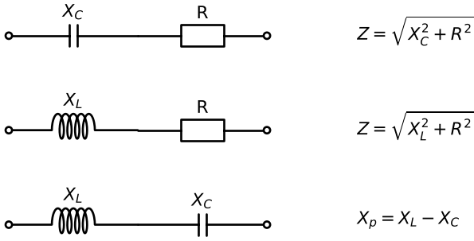

📘 Л1, рис.24 · 📗 «Основы», слайд 8

- C и R: **Z = √(X<sub>C</sub>² + R²)**; L и R: **Z = √(X<sub>L</sub>² + R²)** — складывать просто так нельзя из-за сдвига фаз.
- L и C: их сопротивления направлены **противоположно**, результирующее направлено в сторону большего: **X<sub>р</sub> = X<sub>L</sub> − X<sub>C</sub>** (при X<sub>L</sub> > X<sub>C</sub>) (📘 Л1).

### Схема 5.2. Последовательный колебательный контур

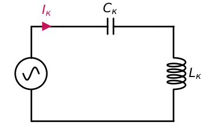

📘 Л1, рис.25 · 📗 «Основы», слайд 8, рис.25 — 🔁 **P8**

### Схема 5.3. Параллельный колебательный контур

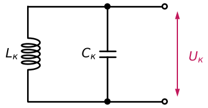

📘 Л1, рис.25 · 📗 «Основы», слайд 8, рис.25 — 🔁 **P8**

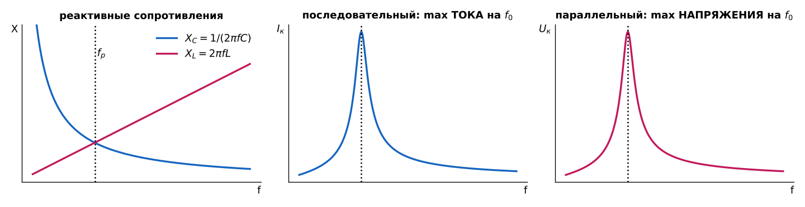

**Зачем эти графики (рис.25).**
- **Левый:** X<sub>C</sub> с ростом частоты падает, X<sub>L</sub> растёт. В точке пересечения **f<sub>р</sub>** они равны: X<sub>L</sub> = X<sub>C</sub>. **f<sub>0</sub> = 1/(2π√(L<sub>к</sub>C<sub>к</sub>))** (📗 «Основы», слайд 9).
- **Последовательный контур (средний):** на f<sub>р</sub> реактивные сопротивления компенсируются, общее сопротивление **наименьшее**, происходит резкое увеличение **тока** I<sub>к</sub> («резонанс тока», 📘 Л1).
- **Параллельный контур (правый):** до резонанса X<sub>C</sub> очень велико, а X<sub>L</sub> очень мало. С ростом частоты X<sub>L</sub> растёт, и сопротивление контура растёт. В точке f<sub>р</sub> контур обладает **максимальным сопротивлением**, дальше начинает уменьшаться X<sub>C</sub>. Максимум **напряжения** U<sub>к</sub> («резонанс напряжений», 📘 Л1).
- Запоминайте по графику, что растёт на f<sub>0</sub>: у последовательного — ток, у параллельного — напряжение на контуре.

### Схема 5.4. Шунтированный контур и добротность

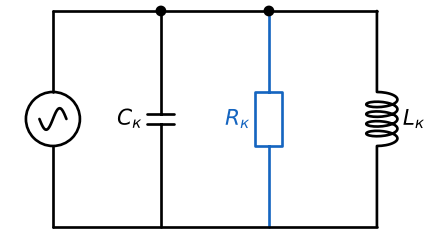

📘 Л1, рис.26–27 · 📗 «Основы», слайд 9

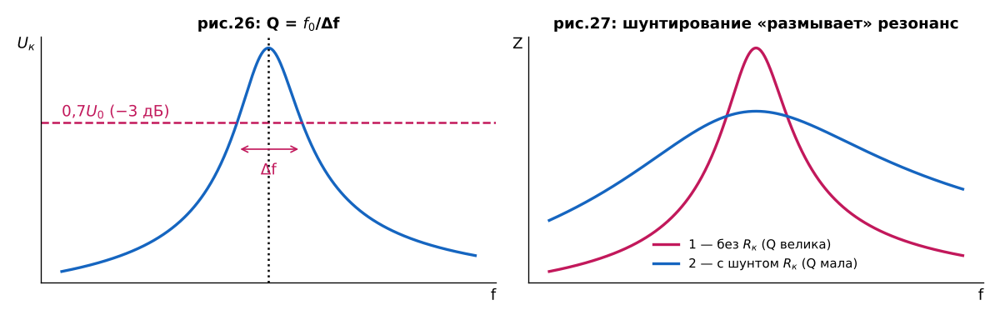

**Зачем эти графики.**
- **Рис.26:** ширину резонансной кривой **Δf** берут на уровне **0,7·U<sub>0</sub>** (−3 дБ; U<sub>1</sub>/U<sub>2</sub> [дБ] = 20 lg(U<sub>1</sub>/U<sub>2</sub>)). **Добротность Q = f<sub>0</sub>/Δf.** Δf — «размытость» контура: чем она больше, тем ниже добротность. Характеристика должна быть «остронаправленной» (📘 Л1).
- **Рис.27:** если в контур ввести дополнительное сопротивление (**зашунтировать контур резистором R<sub>к</sub>**), характеристика размывается (кривая 2), добротность падает.
- 💡 Отсюда правило для гибридных схем: **всё, что подключено к контуру, не должно его шунтировать**. Поэтому цепь управления варикондом подключают через *большой* резистор (уровень 9, H1).
- Главное применение контура — **радиоприёмник** (📘 Л1): уровень 9, H2.

### ❓ Проверь себя (уровень 5)

1. Как меняются X<sub>C</sub> и X<sub>L</sub> с частотой? Что происходит в точке их пересечения?
2. Почему радиоприёмник с широкой полосой Δf плох?
3. Что сделает с контуром резистор, подключённый параллельно?

<details><summary>Ответ</summary>

1. X<sub>C</sub> падает, X<sub>L</sub> растёт. В точке пересечения — резонанс: f<sub>0</sub> = 1/(2π√(LC)).
2. «Если ширина захвата контура большая, то мы захватим несколько радиостанций» (📘 Л1).
3. Зашунтирует: резонансная кривая размоется, добротность Q упадёт.

</details>

---

## Уровень 6. Трансформатор

### 6.0. Принцип действия и основные формулы

📘 Л4, рис.1–3 · 📗 «Трансформаторы», слайд 1

- Трансформатор **преобразует напряжения, токи и сопротивления, но не мощность**: подведённая к первичной обмотке мощность примерно равна снимаемой со вторичной (минус потери). **КПД 96–99 %.**
- **Принцип:** при взаимном перемещении магнита и катушки в катушке возникает ЭДС (рис.2). В трансформаторе роль «движущегося магнита» играет первичная обмотка, подключённая к генератору переменного сигнала. **Трансформатор работает только на переменном токе**; постоянный ток сначала превращают в переменный (📘 Л4).
- **Формулы (слайд 1):**
  U<sub>1</sub>·n<sub>2</sub> = U<sub>2</sub>·n<sub>1</sub>; I<sub>1</sub>·n<sub>1</sub> = I<sub>2</sub>·n<sub>2</sub> → **U<sub>1</sub>/U<sub>2</sub> = n<sub>1</sub>/n<sub>2</sub>**, **I<sub>1</sub>/I<sub>2</sub> = n<sub>2</sub>/n<sub>1</sub>**; коэффициент трансформации **n = n<sub>1</sub>/n<sub>2</sub>**.
  «Во сколько раз изменится напряжение, во столько же раз изменится ток» (в обратную сторону).
- **Витков на вольт:** N = n<sub>1</sub>/U<sub>1</sub> = n<sub>2</sub>/U<sub>2</sub>, причём **N ≥ N<sub>min</sub>**, иначе при большом токе трансформатор может сгореть. Сопротивление обмотки имеет омическую и индуктивную составляющие. N<sub>min</sub> зависит от индуктивного сопротивления витка: периметра, материала и конструкции магнитопровода, частоты (📘 Л4).

### Схема 6.1. Понижающий и повышающий трансформатор

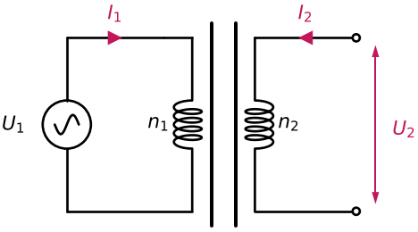

📘 Л4, рис.1 · 📗 «Трансформаторы», слайд 1, рис.1

- n<sub>2</sub> < n<sub>1</sub> → U<sub>2</sub> < U<sub>1</sub> — **понижающий**; n<sub>2</sub> > n<sub>1</sub> — **повышающий**.
- Обмотки связаны только магнитным потоком через сердечник, электрически они изолированы (📗 «Трансформаторы», п.1.1).

### Схема 6.2. Трансформатор как преобразователь сопротивления

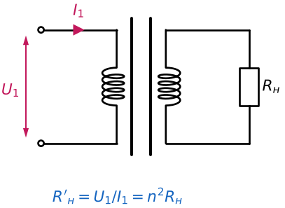

📘 Л4, рис.3–4 · 📗 «Трансформаторы», слайды 1–2

- Раз трансформатор меняет U и I, он меняет и сопротивление, которое «видит» источник. Внутри блока ПС — коэффициент преобразования K<sub>п</sub> = R′<sub>н</sub>/R<sub>н</sub>, где R′<sub>н</sub> = U<sub>1</sub>/I<sub>1</sub>, R<sub>н</sub> = U<sub>2</sub>/I<sub>2</sub>.
- **R′<sub>н</sub>/R<sub>н</sub> = (U<sub>1</sub>/I<sub>1</sub>)·(I<sub>2</sub>/U<sub>2</sub>) = n² → R′<sub>н</sub> = R<sub>н</sub>·n².**
  Пример со слайда: R<sub>н</sub> = 100 Ом, n = 2 → R′<sub>н</sub> = 400 Ом.

### Схема 6.3. Согласование генератора и нагрузки

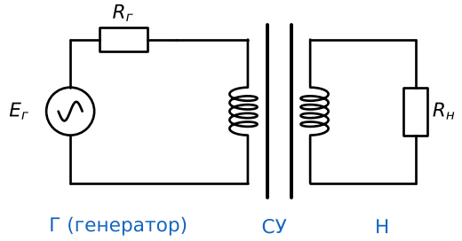

📘 Л4, рис.9–12 · 📗 «Трансформаторы», слайды 3–4

- У генератора есть ЭДС E<sub>Г</sub> и внутреннее сопротивление R<sub>Г</sub> (это Схема 1.7!). К передаче сигнала бывают разные требования: максимальное напряжение, ток или мощность в нагрузке (📘 Л4). Если нужно передать **максимальную мощность**, должно быть **R<sub>н</sub> = R<sub>Г</sub>**:

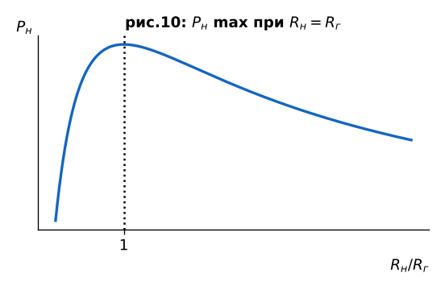

**Зачем этот график (рис.10):** по оси X — отношение R<sub>н</sub>/R<sub>Г</sub>, по оси Y — мощность в нагрузке; максимум ровно при отношении 1. Поэтому, если нагрузка «не та», её надо преобразовать (Схема 6.2).
- Чтобы выровнять сопротивления, ставят **согласующее устройство (СУ)**, например трансформатор.
  Пример со слайда: R<sub>Г</sub> = 1000 Ом, R<sub>н</sub> = 10 Ом → нужно R′<sub>н</sub> = 1000 Ом → n² = 1000/10 = 100 → **n = 10**.

### Схема 6.4. Расщепление сигнала

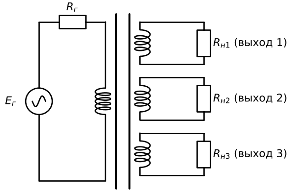

📘 Л4, рис.13–14 · 📗 «Трансформаторы», слайд 4

- Одна первичная обмотка и несколько вторичных: из одного сигнала получаем три одинаковых (📘 Л4).

### Схема 6.5. Расщепление фазы: средний вывод

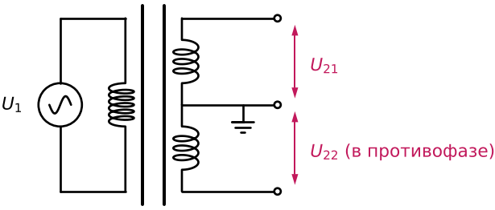

📘 Л4, рис.15 · 📗 «Трансформаторы», слайд 4, рис.15

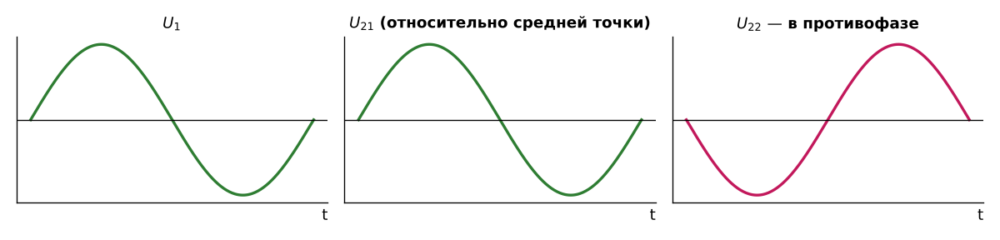

**Зачем этот график.** Вторичная обмотка имеет средний вывод, соединённый с «землёй». Относительно него сигналы U<sub>21</sub> и U<sub>22</sub> получаются **противофазными** (📘 Л4).
💡 Запомните: двухтактному усилителю (уровень 9, H18) нужен как раз «фазоинвертор», который даёт два противофазных сигнала.

### Схема 6.6. Гальваническая развязка


📘 Л4, рис.16–17 · 📗 «Трансформаторы», слайд 5

- Цепи не должны сообщаться электрически, но сигнал должен передаваться. Развязывающий элемент — трансформатор (📘 Л4). Сравните с конденсатором (Схема 4.7): тот развязывает только для высоких частот.

### Схема 6.7. Автотрансформатор


📘 Л4, рис.24 · 📗 «Трансформаторы», слайд 7

- Однообмоточный трансформатор с отводом; на рисунке понижающий (📘 Л4). Конспект уточняет: **гальванической развязки у него нет**, потому что вход и выход — одна обмотка.

### 6.8. Соединение обмоток (трансформаторы питания)


📘 Л4, рис.19–23 · 📗 «Трансформаторы», слайды 5–6

- **Точка у обмотки** отмечает её начало: по ней учитывают фазировку и полярность (📘 Л4). РО — рабочие обмотки, КО — компенсационные (рис.19).
- **Последовательно согласно:** U = U<sub>1</sub> + U<sub>2</sub>. **Последовательно встречно:** U = U<sub>1</sub> − U<sub>2</sub> (U<sub>1</sub> > U<sub>2</sub>).
- **Параллельно — только при U<sub>1</sub> = U<sub>2</sub>** (и одинаковой фазе), тогда I = I<sub>1</sub> + I<sub>2</sub> (рис.21). Иначе возникнет большой уравнительный ток (📗 «Трансформаторы», п.4.2).

**Задача со слайда 6 (рис.22–23).** Есть два трансформатора:

| | I<sub>2</sub> | 1р, 2р | 3р, 4р | 1к, 2к (компенсационные) |
|---|---|---|---|---|
| ТПП204-127/220-50 | 94 мА | 2,5 В | 5,0 В | 1,3 В |
| ТПП247-127/220-50 | 223 мА | 10 В | 20 В | 2,58 В |

Нужно получить: (1) 5 В, 150 мА и 5 В, 50 мА; (2) 7,5 В, 200 мА.
- (1) на ТПП204: **5 В, 50 мА** — U<sub>21</sub> + U<sub>22</sub> последовательно (2,5 + 2,5 = 5 В; ток 94 мА ≥ 50 мА); **5 В, 150 мА** — U<sub>23</sub>‖U<sub>24</sub> параллельно (5 В; 2·94 = 188 мА ≥ 150 мА).
- (2) ток 200 мА даёт только ТПП247 (223 мА): рабочая 10 В **встречно** с компенсационной 2,58 В → ≈ 7,5 В.

<details><summary>Справка к экзамену: обозначения и классификация трансформаторов (📘 Л4, слайды 5, 7)</summary>

- **ТА5-127/220-50-В:** Т — трансформатор; А — анодный (Н — накальный, АН — анодно-накальный, ПП — для питания полупроводниковых приборов, С — силовой); 5 — порядковый номер разработки; 127/220 — напряжение первичной обмотки; 50 — рабочая частота, Гц; В — всеклиматическое исполнение (также ТС — тропическо-сухое, ТВ — тропическо-влажное, УХЛ — умеренно-холодное).
- **Классификация:** по назначению — ТП (питания), СТ (согласующие), ИТ (импульсные); по частоте — пониженной (< 50 Гц), промышленной (50, 60 Гц), повышенной промышленной (400, 800, 1000 Гц), повышенной (до 10 кГц), высокой (> 10 кГц); по напряжению — НТ (≤ 1 кВ), ВТ (> 1 кВ); по числу обмоток — однообмоточные (автотрансформаторы), двухобмоточные, многообмоточные; по магнитопроводу — пластинчатый, ленточный, прессованный. Пластинчатый уменьшает потери, ленточный — ещё сильнее; у прессованных потери зависят от пропитки обмотки.

</details>

### ❓ Проверь себя (уровень 6)

1. Почему трансформатор не работает на постоянном токе?
2. Трансформатор понижает напряжение в 10 раз. Что происходит с током и с сопротивлением нагрузки, «видимым» с первичной стороны?
3. Можно ли включить параллельно обмотки на 5 В и на 10 В?

<details><summary>Ответ</summary>

1. ЭДС во вторичной обмотке возникает только при изменении магнитного потока, а постоянный ток поток не меняет.
2. Ток во вторичной цепи увеличивается в 10 раз (по отношению к первичному). R′<sub>н</sub> = n²·R<sub>н</sub> = 100·R<sub>н</sub>.
3. Нет: параллельно — только обмотки с одинаковым напряжением и фазой, иначе потечёт большой уравнительный ток.

</details>

---


## Уровень 7. Диод и его «родственники»

### 7.0. p-n-переход — сердце диода

📘 Л5, п.1–2, 4 · 📗 «Диоды», слайды 1–3

- **Диод** — полупроводниковый прибор, пропускающий ток в одном направлении: **от анода (+) к катоду (−)**. Основа полупроводникового диода — **p-n-переход** (📘 Л5).
- p-область: недостаток электронов, «дырки» (акцепторная примесь). n-область: избыток электронов (донорная примесь).
- Между ними — **область, обеднённая носителями** (ширина δ). По свойствам она соответствует диэлектрику, поэтому **«система похожа на конденсатор»** (📘 Л5): C<sub>к</sub> = ε<sub>0</sub>εS/r — ёмкость обычного конденсатора, **C<sub>п</sub> = ε<sub>0</sub>εS/δ** — ёмкость p-n-перехода. Это та же формула, что на уровне 4! Она понадобится для варикапа (Схема 7.11) и для быстродействия (Схема 7.2).
- На схеме полоска символа — катод.


**Прямое и обратное смещение (📘 Л5, п.2, рис.2; слайд 1, рис.2).** При прямом напряжении диод открыт и пропускает ток. При обратном закрыт, но не полностью: есть очень маленький обратный ток (I<sub>пр</sub> ≫ I<sub>обр</sub>). Важные параметры: I<sub>пр</sub>, I<sub>обр</sub>, U<sub>пр</sub>.


**Зачем этот график — вольт-амперная характеристика (📘 Л5, п.4, рис.10; слайд 2, рис.5–6).**
- **Прямая ветвь** растёт экспоненциально. Прямое напряжение не может превысить ограничительного значения U<sub>пр.огр</sub> (на рисунке U′<sub>пр</sub>) — поэтому «диоды применяются как ограничители напряжения» (📘 Л5).
- **Обратная ветвь:** маленький ток, пока обратное напряжение не дойдёт до **U<sub>пробоя</sub>**. Тогда диод будет пробит, и это **безвозвратное повреждение** (📘 Л5).
- **Справа:** у **кремния (Si)** прямое напряжение больше, чем у **германия (Ge)**.
- Конспект добавляет: из-за крутой ветви ток нельзя ограничивать «самим диодом», нужен резистор или источник с ограничением тока. Это уже знакомый **P2** из Схемы 3.2.

**Формула Эберса–Молла (слайд 3, формула 1):** I<sub>пр</sub> = I<sub>0</sub>·[e<sup>U<sub>пр</sub>/(m·φ<sub>т</sub>)</sup> − 1], где φ<sub>т</sub> = 25,5 мВ — термический потенциал при нормальной температуре, m = 1…2, а φ<sub>т</sub> и I<sub>0</sub> зависят от температуры.
**Следствие:** если I<sub>пр</sub> = const, то U<sub>пр</sub> = φ(t°), и **∂U<sub>пр</sub>/∂T ≈ −2 мВ/К**. «Диод является превосходным датчиком температуры» (📘 Л5).

Ниже — три простейшие схемы с диодом, на каждой видна одна его грань.

### Схема 7.1. Защита от переполюсовки (диод + нагрузка)


📘 Л5, п.2, рис.5 · 📗 «Диоды», слайд 1, рис.4–5

- При правильной полярности диод открыт, и нагрузка получает **U<sub>н</sub> = E − U<sub>пр</sub>**. Пример: E = 9 В, U<sub>пр</sub> = 0,6 В, R<sub>н</sub> = 1 кОм → U<sub>н</sub> = 8,4 В, I<sub>н</sub> = 8,4 мА.
- При неправильной полярности диод **заблокирует** ток.
- **Цена защиты:** на диоде падает U<sub>пр</sub>, и нагрузка его «недополучает», поэтому падает и I<sub>н</sub> (📘 Л5).

### Схема 7.2. Диод на импульсах: динамический режим


📘 Л5, п.7 · 📗 «Диоды», слайд 4, рис.1–2


**Зачем этот график.** Генератор сначала даёт плюс, и диод открыт. Потом полярность меняется на минус, и диод закрывается, но **не мгновенно, а через время запаздывания t<sub>з</sub>**. Причина: пока диод открыт, в области p-n-перехода скапливаются носители заряда, и они не сразу покидают переход. t<sub>з</sub> зависит от типа диода и геометрии перехода. **Чем на больший ток рассчитан диод, тем больше t<sub>з</sub>** (📘 Л5).
- Точечные диоды быстрее (меньше площадь → меньше ёмкость C<sub>п</sub>), плоскостные медленнее (📘 Л5, п.6).
- **Диод Шоттки** — сверхбыстрый: t<sub>з</sub> ≈ 10 пс.

### Схема 7.3. Простейший диодный ограничитель


📘 Л5, п.15 · 📗 «Диоды», слайд 10, рис.1а — 🔁 **P3**


**Зачем этот график.** Положительная полуволна проходит (диод заперт). Отрицательная **срезается на уровне −U<sub>пр</sub>**: диод открывается, и напряжение на нём не может стать больше прямого (ВАХ выше).
- **R<sub>б</sub> обязателен:** он принимает на себя лишнее напряжение и не даёт ограничивающей ветви стать коротким замыканием (📗 «Диоды», слайд 10).
- 💡 Сравните со Схемой 3.6 (варистор): структура та же, P3. Только варистор ограничивает обе полярности, а один диод — одну.

### 7.4. Кремний или германий — на конкретных схемах

📘 Л5, п.5 · 📗 «Диоды», слайд 3

**Схема 7.4а. Защита линии от динамика — кремний.**


Полезный сигнал в линии большой (десятки вольт), поэтому встречно-параллельные VD1, VD2 его не гасят. Внешние звуки создают на динамике низкое напряжение (0,1–0,2 В). Оно **не открывает диоды** и не уходит обратно в линию. Нужно большое прямое напряжение, поэтому берут **кремниевые** диоды (📘 Л5).

**Схема 7.4б. Микроамперметр переменного тока — германий.**


Микроамперметру нужен постоянный ток, поэтому ставится выпрямительный диод VD1. У германия более ровная прямая ветвь ВАХ, и **шкала прибора получается равномернее** (📘 Л5).

**Третий пример (выпрямитель с конденсатором)** — нужен **кремний**, потому что он устойчив к кратковременным импульсным перегрузкам. Разберём его в гибридной схеме H6.

| Свойство (📘 Л5) | Кремний | Германий |
|---|---|---|
| Прямое напряжение | больше | меньше |
| Стабильность параметров во времени | выше | ниже |
| Предельная температура | +200 °C | +90 °C |
| Обратный ток | намного меньше | больше |
| Обратное напряжение | до 1,5–2 кВ | до 400–600 В |
| Импульсные перегрузки | устойчив | неустойчив |

### 7.5. Выпрямительные диоды: температура и параметры


**Зачем эти графики (📘 Л5, п.8; слайд 4, рис.3–4).**
- **Ge:** при росте температуры и неизменном прямом напряжении прямой ток растёт. **Напряжение пробоя с ростом t° уменьшается.**
- **Si:** прямой ток при нагреве тоже растёт, но **напряжение пробоя возрастает**; при неизменном прямом токе прямое напряжение падает.

**Параметры (📘 Л5, п.9):** 1) U<sub>пр</sub> при заданном I<sub>пр</sub>; 2) **U<sub>обр</sub>** — какие напряжения можно выпрямлять; 3) **I<sub>пр</sub>** — какой ток можно выпрямить; 4) I<sub>обр</sub> при заданном U<sub>обр</sub>; 5) I<sub>пр.имп</sub> при заданном времени импульсной перегрузки; 6) дифференциальное сопротивление R<sub>д</sub> = ΔU<sub>пр</sub>/ΔI<sub>пр</sub>. **Самые важные — 2 и 3.**
Конспект: при выпрямлении сети 220 В учитывают амплитуду ≈311 В (уровень 2) и берут U<sub>обр</sub> с запасом.

### Схема 7.6. Параллельное соединение диодов


📘 Л5, п.10 · 📗 «Диоды», слайд 5, рис.1–4


- **Зачем параллельно:** увеличить выпрямленный ток. I<sub>р</sub> = I<sub>1</sub> + I<sub>2</sub>; реально I<sub>р</sub> = I·n·k, где k < 1 — поправочный коэффициент.
- **Проблема (график):** напряжение на диодах одно (параллель), но прямые сопротивления разные даже в одной партии, поэтому I<sub>1</sub> > I<sub>2</sub>. Пример из лекции: два диода по 10 А, ток 20 А. Через VD1 пойдёт больше 10 А, он сгорит, затем все 20 А пойдут через VD2 — сгорит и он.
- **Решение:** два одинаковых резистора R1 = R2 последовательно с диодами. U<sub>1</sub> + U′<sub>1</sub> = U<sub>2</sub> + U′<sub>2</sub>: если I<sub>1</sub> > I<sub>2</sub>, то U<sub>1</sub> > U<sub>2</sub> на резисторах, значит U′<sub>1</sub> < U′<sub>2</sub> на диодах, и ток VD1 уменьшается. Разность токов стремится к нулю — это **выравнивание токов** (📘 Л5).

### Схема 7.7. Последовательное соединение диодов


📘 Л5, п.10 · 📗 «Диоды», слайд 5, рис.5–6

- **Зачем последовательно:** увеличить выпрямляемое напряжение.
- **Проблема:** разные обратные сопротивления, а «на большем падает большее» (правило уровня 1!). При 400 В на VD1 может упасть больше 200 В: он пробьётся, затем все 400 В лягут на VD2.
- **Решение:** **шунтировать каждый диод резистором R<sub>ш</sub>**, много меньшим обратного сопротивления диода. Тогда сопротивление каждой секции ≈ R<sub>ш</sub>, и напряжения выравниваются (200 В + 200 В). Это опять делитель P1!

### 7.8. ВЧ-диоды, импульсные диоды, Шоттки, ДНЗ

📘 Л5, п.11–12 · 📗 «Диоды», слайды 6–7


**Зачем эти графики (слева направо):**
1. **ВЧ-диод:** с ростом частоты выпрямленный ток падает (из-за времени запаздывания, Схема 7.2). Когда он упадёт до **0,7·I<sub>0</sub>**, отмечают **f<sub>max</sub>**. Второй параметр — ёмкость перехода C<sub>п</sub>.
2. **Импульсный диод, включение:** при импульсе прямого тока напряжение сначала выскакивает до U<sub>пр.имп</sub>, затем спадает к U<sub>пр.уст</sub>. Время, за которое всплеск угаснет до **1,2·U<sub>пр.уст</sub>**, — **t<sub>уст</sub>**. Импульсное сопротивление R<sub>имп</sub> = U<sub>пр.имп</sub>/I<sub>пр.имп</sub>.
3. **Импульсный диод, выключение:** обратный ток сначала соизмерим с прямым («колоссальный всплеск» до I<sub>обр.имп</sub>), затем за **t<sub>восст</sub>** угасает. Параметры: R<sub>имп.макс</sub>, U<sub>пр.имп.макс</sub>, I<sub>пр.имп</sub>, t<sub>восст</sub> (иногда I<sub>обр.имп</sub>).
4. **Диод с накоплением заряда (ДНЗ):** обратный ток долго (t<sub>1</sub>) равен прямому, затем за короткое t<sub>2</sub> спадает. Применяют для **прямоугольных импульсов с очень крутыми фронтами**.

**Диод Шоттки (слайд 2, рис.1; слайд 6, рис.4):** металл (3) + тонкая высокоомная плёнка n-типа (2) + низкоомная пластина n-типа (1). По правилу «на большем падает большее» всё поле сосредоточено в тонкой плёнке, где напряжённость доходит до ~10000 В/см даже при < 1 В. Процессы идут на порядки быстрее, чем в p-n: **~10 пс** (📘 Л5).

### 7.9. Стабилитрон и стабистор

📘 Л5, п.13 · 📗 «Диоды», слайд 7

Стабилитрон — особый диод, который **работает на обратной ветви ВАХ** (в пробое, но обратимом).

### Схема 7.10. Параметрический стабилизатор (стабилитрон + балласт)


📘 Л5, п.13, рис.3 · 📗 «Диоды», слайд 7, рис.3 — 🔁 **P3**


**Зачем эти графики:**
- **ВАХ (рис.2):** у **идеального** стабилитрона (синяя) при U<sub>обр</sub> = U<sub>ст</sub> ток может быть любым, а напряжение постоянно. У **реального** (зелёная) с ростом тока немного растёт и U<sub>ст</sub>. **R<sub>д</sub> = ΔU<sub>ст</sub>/ΔI<sub>ст</sub>** — качество стабилизации, чем меньше, тем лучше. Геометрически это тангенс угла наклона реальной характеристики к идеальной. Работает только при **I<sub>ст.min</sub> ≤ I<sub>ст</sub> ≤ I<sub>ст.max</sub>**.
- **U<sub>н</sub>(U<sub>вх</sub>) (рис.4):** до U<sub>ст</sub> стабилитрон закрыт, и выход повторяет вход. Дальше идёт режим стабилизации: рост U<sub>н</sub> сильно замедляется (в идеале отсутствует). **K<sub>ст</sub> ≈ ΔU<sub>вх</sub>/ΔU<sub>н</sub>** — коэффициент стабилизации.
- **Шум (рис.5):** если **I<sub>ст</sub> < I<sub>ст.min</sub>**, напряжение начинает хаотично меняться. Это используют в генераторах шума.
- Если **I<sub>ст</sub> > I<sub>ст.max</sub>**, растёт **P<sub>рас</sub> = U<sub>ст</sub>·I<sub>ст</sub>**: стабилитрон перегревается и может выйти из строя (рис.6).

**Как работает схема:** U<sub>вх</sub> = U<sub>б</sub> + U<sub>н</sub>; U<sub>н</sub> = const; U<sub>вх</sub> меняется → меняется U<sub>б</sub>. «Всё лишнее напряжение падает на балластном резисторе R<sub>б</sub>» (📘 Л5). Формулы конспекта: I<sub>R</sub> = (U<sub>вх</sub> − U<sub>ст</sub>)/R<sub>б</sub>; I<sub>R</sub> = I<sub>ст</sub> + I<sub>н</sub>.
💡 Опять P3: сравните со Схемами 3.6 и 7.3.

**Параметры (слайд 7):** U<sub>ст</sub> (U<sub>ст.min</sub>…U<sub>ст.max</sub>); I<sub>ст</sub> (I<sub>ст.min</sub>…I<sub>ст.max</sub>); R<sub>д</sub>; температурный коэффициент α<sub>Uст</sub> = (U<sub>ст2</sub> − U<sub>ст1</sub>)/(t<sub>2</sub> − t<sub>1</sub>) при I<sub>ст</sub> = const (бывает и «+», и «−»).

**Стабистор** выполняет ту же функцию, но для **низких напряжений**. До ~3 В условий для пробоя p-n-перехода не возникает, поэтому стабистор использует **прямую** ветвь ВАХ (📘 Л5).

### Схема 7.11. Варикап — управляемый конденсатор


📘 Л5, п.3 и п.14 · 📗 «Диоды», слайды 2 и 8

- Варикап — диод с **увеличенной ёмкостью p-n-перехода**, «нелинейный конденсатор». Включается **обратно**.
- При U<sub>обр</sub> = 0 ёмкость максимальна (δ минимальна). **U<sub>обр</sub>↑ → δ↑ → C<sub>п</sub>↓** (📘 Л5) — то же C = ε<sub>0</sub>εS/d, только «расстояние между обкладками» d — ширина обеднённой области, d = F(U<sub>см</sub>).
- **Формула со слайда 8:** C = C<sub>0</sub>·(φ<sub>к</sub>/(φ<sub>к</sub> + U<sub>см</sub>))<sup>1/n</sup>, n = 2…3; C<sub>0</sub> — ёмкость при нулевом напряжении, φ<sub>к</sub> — контактный потенциал.
  ⚠️ В конспекте формула записана со степенью n вместо 1/n. Следуйте слайду (лекции).


**Зачем этот график:** показывает форму зависимости ёмкости от обратного напряжения по формуле со слайда (C<sub>0</sub> и φ<sub>к</sub> условные). Ёмкость быстро падает в начале и медленнее потом.

**Параметры (слайд 8, рис.3–4):** добротность Q<sub>в</sub> = 12…500 (отношение X<sub>C</sub> к сопротивлению потерь, чем больше, тем лучше); коэффициент перекрытия K<sub>c</sub> = 2,5…6,0 (отношение ёмкостей при U<sub>min</sub> и U<sub>max</sub>); общая ёмкость C<sub>в</sub> = 2…600 пФ (обычно максимальная, при минимальном U<sub>обр</sub>). Пример: варикапная матрица КВС111А(Б) — m = 0,2 г, t = −60…+100 °C, U<sub>см.max</sub> = 30 В, Q<sub>в</sub>: 111Б ≥ 150, 111А ≥ 200. **Варактор** — варикап для умножения частоты.
💡 В колебательном контуре варикап заменяет переменный конденсатор → уровень 9, H2.

### Схема 7.12. Семейство ограничителей

📘 Л5, п.15 · 📗 «Диоды», слайд 10, рис.1 б–д — 🔁 **P3**

**б)** последовательно с VD1 источник опорного напряжения U<sub>оп</sub>: уровень среза сдвигается до −(U<sub>пр</sub> + U<sub>оп</sub>).

| Схема | Осциллограмма |
|---|---|
|  |  |

**в)** две ветви по два диода, навстречу друг другу: двусторонний срез на ±2U<sub>пр</sub>.

| Схема | Осциллограмма |
|---|---|
|  |  |

**г)** два прибора навстречу: каждый срезает «свою» полуволну своим прямым напряжением (+U<sub>пр2</sub> и −U<sub>пр1</sub>).

| Схема | Осциллограмма |
|---|---|
|  |  |

**д)** стабилитрон VD1 + диод VD2: положительная полуволна срезается пробоем стабилитрона (+U<sub>ст1</sub>), отрицательная — прямым напряжением открывшихся диодов (−min(U<sub>пр1</sub>, U<sub>пр2</sub>)).

| Схема | Осциллограмма |
|---|---|
|  |  |

### Схема 7.13. Четыре «датчиковые» схемы с диодом

📘 Л5, п.15 · 📗 «Диоды», слайд 11 — 🔁 **P9**

**Нелинейный (логарифмический) преобразователь.** На диод подают управляемый ток I<sub>вх</sub> и снимают прямое напряжение. По ВАХ U<sub>вых</sub> = F(I<sub>вх</sub>) — **логарифмическая** зависимость.


**Генератор шума (ГШ).** Стабилитрон, смещённый очень малым током (I<sub>ст</sub> < I<sub>ст.min</sub>, см. рис.5 выше). Специальный генераторный диод 2Г401, f<sub>max</sub> → 3,5 МГц.


**Магнитодиод — датчик поля.** ВАХ сильно зависит от индукции B и её направления относительно перехода; используют в прямом смещении. КД301В: при B = 0 — I<sub>пр</sub> = 3 мА, U<sub>пр</sub> = 10 В; при B = 0,4·B<sub>max</sub> — I<sub>пр</sub> = 3 мА, U<sub>пр</sub> = 32 В.


**Термометр.** При постоянном прямом токе U<sub>пр</sub> = F(t°) (−2 мВ/К). Электронный термометр (ЭТ) подключают к диодному датчику (ДТ) соединительными проводами (СП).


### ❓ Проверь себя (уровень 7)

1. Почему p-n-переход сравнивают с конденсатором? Где это используется?
2. Зачем в любой схеме с диодом-ограничителем нужен R<sub>б</sub>?
3. Что будет, если I<sub>ст</sub> < I<sub>ст.min</sub>? А если I<sub>ст</sub> > I<sub>ст.max</sub>?
4. Почему для выпрямителя с конденсатором берут кремниевый диод, а для микроамперметра — германиевый?
5. Зачем резисторы при параллельном и при последовательном соединении диодов? Чем эти случаи отличаются?

<details><summary>Ответ</summary>

1. Обеднённая область — диэлектрик между проводящими p и n: C<sub>п</sub> = ε<sub>0</sub>εS/δ. Используется в варикапе; эта же ёмкость ограничивает быстродействие (ВЧ-диоды делают с малой площадью).
2. Он принимает лишнее напряжение и ограничивает ток; без него открытый диод закоротил бы источник.
3. Меньше минимума — стабилизация пропадает, появляется шум (используют в генераторах шума). Больше максимума — перегрев от P = U<sub>ст</sub>·I<sub>ст</sub> и выход из строя.
4. Кремний выдерживает бросок тока при включении (конденсатор разряжен = КЗ). Германий — из-за ровной прямой ветви: шкала равномернее.
5. Параллельно: последовательные R выравнивают **токи** (разные прямые сопротивления). Последовательно: параллельные R<sub>ш</sub> выравнивают **обратные напряжения** (разные обратные сопротивления).

</details>

---

## Уровень 8. Транзистор

### 8.0. Зачем нужен транзистор: от ручки к электронному управлению

📘 Л1, рис.7–11 · 📗 «Основы», слайд 3

- В Схемах 1.3 и 1.8 ключом и переменным резистором управляла рука. Нужны элементы, которые будут управляться электрически: **электронная лампа и транзистор** (📘 Л1).
- **Лампа:** анод (+), катод (−) с подогревом, между ними сетка. Отрицательный потенциал на сетке блокирует электроны — получается **электронный ключ**. Слабый положительный «разгоняет» их.
- **Транзистор действует аналогично:** **коллектор ≈ анод, эмиттер ≈ катод, база ≈ сетка**. Минусы транзистора: плохо переносит ионизирующее излучение, сильно зависит от температуры окружающей среды и внешнего э/м воздействия (📘 Л1).
- Рис.8–9 лекции: «ключ» и «переменный резистор» можно сделать механическим, на переходе коллектор–эмиттер транзистора или на переходе анод–катод лампы.

### 8.1. Биполярный и полевой — чем отличаются

| | Биполярный (БТ) | Полевой (ПТ) |
|---|---|---|
| Управление | **током** (базы) | **напряжением** (затвор–исток) |
| Мощность управления P<sub>упр</sub> | больше ↑ | меньше ↓ |
| Входное сопротивление R<sub>вх</sub> | меньше ↓ | больше ↑ |
| ТЧ (по слайду) | ↑ | ↓ |
| РПХ (по слайду) | ↓ | ↑ |

📗 «Транзисторы», слайд 1. Сокращения «ТЧ» и «РПХ» на слайде не расшифрованы. Конспект отмечает, что биполярным нужна тщательная температурная стабилизация, а у полевых температурная устойчивость «часто выше».

### 8.2. Устройство и подключение биполярного транзистора


📗 «Транзисторы», слайд 1, рис.1–2

- Три слоя: **p-n-p** или **n-p-n**. Эмиттер (Э), база (Б), коллектор (К). Стрелка эмиттера: у n-p-n наружу, у p-n-p внутрь.
- **Полярности:** у n-p-n «+» E<sub>к</sub> на коллекторе и «+» E<sub>б</sub> на базе; у p-n-p всё наоборот (минусы). На слайдах про усилители транзисторы **p-n-p**, поэтому там «−E<sub>к</sub>» сверху.
- **Формулы:** **I<sub>э</sub> = I<sub>к</sub> + I<sub>б</sub>** (1); **I<sub>к</sub> = β·I<sub>б</sub>, β = I<sub>к</sub>/I<sub>б</sub> ≫ 1** (2); **I<sub>э</sub> ≈ I<sub>к</sub>** (3).


- **Транзистор = два p-n-перехода** (слайд 1, рис.2г). Значит, вход база–эмиттер ведёт себя как **диод** (уровень 7). Поэтому входная характеристика похожа на ВАХ диода, а ток базы надо ограничивать резистором.
- **Условия активного (усилительного) режима для n-p-n (слайд 4):** U<sub>к</sub> > U<sub>э</sub> + U<sub>кэ.нас</sub>; переход Б–Э открыт (U<sub>бэ</sub> = U<sub>пр</sub>), переход Б–К закрыт (U<sub>бк</sub> = U<sub>обр</sub>); I<sub>к</sub> < I<sub>к.max</sub>, I<sub>б</sub> < I<sub>б.max</sub>, U<sub>кэ</sub> < U<sub>кэ.max</sub>. Тогда **I<sub>к</sub> = β·I<sub>б</sub>**.

### 8.3. Характеристики


**Зачем эти графики (📗 «Транзисторы», слайды 2 и 6):**
- **Входная I<sub>б</sub>(U<sub>бэ</sub>)** — как у диода. С ростом температуры смещается влево: при том же U<sub>бэ</sub> ток больше. Это корень проблемы термостабильности (уровень 9, H14–H15).
- **Выходные I<sub>к</sub>(U<sub>кэ</sub>)** — семейство кривых при I<sub>б1</sub>…I<sub>б4</sub>: больше I<sub>б</sub> → больше I<sub>к</sub>. Слева узкая область насыщения, в середине рабочая область (Р.О.), где I<sub>к</sub> почти не зависит от U<sub>кэ</sub> и задаётся базой. Справа граница О.П. (по конспекту, при слишком большом U<sub>кэ</sub> возможен пробой).
- **β(f)** — коэффициент передачи тока падает с ростом частоты до 1 на f<sub>гр</sub>.
- Блочные модели (слайд 2, рис.2): I<sub>к</sub> = φ<sub>1</sub>(I<sub>б</sub>) — «I<sub>б</sub> → T → I<sub>к</sub>»; I<sub>к</sub> = φ<sub>2</sub>(U<sub>бэ</sub>) — «U<sub>бэ</sub> → ВХ (входная характеристика) → I<sub>б</sub> → T → I<sub>к</sub>».

### 8.4. Три схемы включения


📗 «Транзисторы», слайд 2, рис.4–5

«Общий» электрод — общая точка входа и выхода по переменному сигналу (📗 «Транзисторы», п.4).

| Схема | Вход / выход | Коэффициент (слайд 2) | Свойство (конспект) |
|---|---|---|---|
| **ОБ** | эмиттер / коллектор | α = dI<sub>к</sub>/dI<sub>э</sub> < 1, α → 1 | малое R<sub>вх</sub>, хорошо на высоких частотах |
| **ОК** | база / эмиттер | dI<sub>э</sub>/dI<sub>б</sub> = 1/(1 − α) | эмиттерный повторитель: R<sub>вх</sub> большое, R<sub>вых</sub> малое, K<sub>U</sub> ≈ 1 |
| **ОЭ** | база / коллектор | β = α/(1 − α) = dI<sub>к</sub>/dI<sub>б</sub> | большое усиление тока и напряжения, выход **в противофазе** |

### Схема 8.1. Транзистор вместо ключа

| Было (Схема 1.3) | Стало |
|---|---|
|  |  |

📘 Л1, рис.10 · 📗 «Основы», слайд 3, рис.10 — 🔁 **P4**

- «Мы можем заменить ключ Кл1 на транзистор VT1. Тогда функцию переключения будет реализовывать транзистор» (📘 Л1). Логика «0/1» та же: VT1 открыт → U<sub>вых</sub> ≈ 0; закрыт → U<sub>вых</sub> = U<sub>п</sub>. Только теперь ключом управляет электрический сигнал на базе, и переключение может быть очень быстрым (📗 «Основы», вопрос 4).

### Схема 8.2. Транзистор вместо переменного резистора — первый настоящий усилитель

| Было (Схема 1.8) | Стало |
|---|---|
|  |  |

📘 Л1, рис.11 · 📗 «Основы», слайд 4, рис.11 — 🔁 **P1**

- «Заменяем R2 на транзистор VT1. Управляющее напряжение подаётся между электродами база–эмиттер, то есть меняется сопротивление перехода коллектор–эмиттер, и тогда транзистор выполняет роль резистора» (📘 Л1).
- Получился **делитель R1 + R<sub>кэ</sub>**: малый сигнал на базе меняет R<sub>кэ</sub>, а с ним и U<sub>2</sub> = U<sub>вых</sub>. Энергия берётся от E<sub>п</sub>. **Это и есть идея усилительного каскада** (уровень 9).

### Схема 8.3. Управление лампой накаливания


📗 «Транзисторы», слайд 3, рис.1–4

- Потенциометр R<sub>р</sub> от E<sub>б</sub> задаёт U<sub>бэ</sub> (делитель P1!). Лампа HL1 — нагрузка в коллекторной цепи E<sub>к</sub>. Всегда **U<sub>HL1</sub> = E<sub>к</sub> − U<sub>кэ</sub>**.

| U<sub>бэ</sub> | U<sub>кэ</sub> | U<sub>HL1</sub> | Транзистор похож на… |
|---|---|---|---|
| 0 | E<sub>к</sub> | 0 (лампа погашена) | разомкнутый ключ: R<sub>кэ.отс</sub>↑ |
| E<sub>б</sub> | 0 (точнее U<sub>кэ.нас</sub>) | E<sub>к</sub> (горит полностью) | замкнутый ключ: R<sub>кэ.нас</sub>↓ |
| 0…E<sub>б</sub> | 0…E<sub>к</sub> | 0…E<sub>к</sub> (яркость плавно) | переменный резистор (рис.3) |

- Конспект («Транзисторы», вопрос 5): лампу ставят в коллекторную цепь, управление подают на базу **через ограничительный резистор**. Для лампы учитывают большой пусковой ток.

### 8.5. Модели транзистора и важные числа

📗 «Транзисторы», слайд 4

1. **Модель усилителя тока:** I<sub>к</sub> = β·I<sub>б</sub> (для простых расчётов, ключей).
2. **Экспоненциальная модель:** I<sub>к</sub> = I<sub>э.обр</sub>·(e<sup>U<sub>бэ</sub>/φ<sub>т</sub></sup> − 1); при I<sub>к</sub> ≫ I<sub>э.обр</sub>: I<sub>к</sub> = I<sub>э.обр</sub>·e<sup>U<sub>бэ</sub>/φ<sub>т</sub></sup>; φ<sub>т</sub> = kT/q = 25,5 мВ при 20 °C (q = 1,6·10⁻¹⁹ Кл, k = 1,38·10⁻²³ Дж/К).
3. **Модель с крутизной:** S = I<sub>к</sub>/U<sub>бэ</sub> («U<sub>бэ</sub> → T(S) → I<sub>к</sub>»).

Следствия со слайда:
- а) U<sub>бэ</sub>↑ → I<sub>к</sub>↑; **ΔU<sub>бэ</sub> = 60 мВ → I<sub>к</sub> увеличивается в 10 раз**;
- б) при +20 °C сопротивление эмиттера r<sub>э</sub> = φ<sub>т</sub>/I<sub>к</sub> ≈ 26/I<sub>к</sub> (r<sub>э</sub> в Ом, I<sub>к</sub> в мА);
- в) **Δt = +1 °C → ΔU<sub>бэ</sub> = −2,1 мВ** (при I<sub>э</sub> = const) — как у диода;
- г) U<sub>бэ</sub> = φ(U<sub>кэ</sub>) при I<sub>к</sub> = const: ΔU<sub>бэ</sub> = α·ΔU<sub>кэ</sub>, α ≈ −0,0001.

### 8.6. Транзистор как четырёхполюсник: h-параметры

📗 «Транзисторы», слайд 5

- **U<sub>1</sub> = h<sub>11</sub>·I<sub>1</sub> + h<sub>12</sub>·U<sub>2</sub>; I<sub>2</sub> = h<sub>21</sub>·I<sub>1</sub> + h<sub>22</sub>·U<sub>2</sub>.**
- h<sub>11</sub> = U<sub>1</sub>/I<sub>1</sub> при U<sub>2</sub> = 0 (входное сопротивление); h<sub>12</sub> = U<sub>1</sub>/U<sub>2</sub> при I<sub>1</sub> = 0 (обратная связь); h<sub>21</sub> = I<sub>2</sub>/I<sub>1</sub> при U<sub>2</sub> = 0 (передача тока); h<sub>22</sub> = I<sub>2</sub>/U<sub>2</sub> при I<sub>1</sub> = 0 (выходная проводимость).
- Для ОЭ — h<sub>11э</sub>…h<sub>22э</sub>, для ОБ — h<sub>11б</sub>…h<sub>22б</sub>; **β = h<sub>21э</sub>**.

### 8.7. Параметры и область безопасной работы

**Параметры (слайд 6):** 1) обратные токи I<sub>кб0</sub>, I<sub>эб0</sub>, I<sub>кэ0</sub>; 2) h-параметры; 3) граничная частота f<sub>гр</sub>, где β = 1; 4) f<sub>h21б</sub>, где α падает до 0,7; 5) f<sub>max</sub>; 6) ёмкость коллектора C<sub>к</sub>; 7) B = I<sub>к</sub>/I<sub>б</sub>; 8) S = I<sub>к</sub>/U<sub>бэ</sub>; 9) U<sub>кэ.нас</sub>; 10) U<sub>бэ.нас</sub>; 11) время τ<sub>р</sub> (на графике слайда: от выключения тока базы до момента, когда напряжение на коллекторе поднимется до уровня 0,1·E<sub>к</sub>); 12) предельные P<sub>к.max</sub>, I<sub>к.max</sub>, U<sub>кэ.max</sub> (U<sub>кб.max</sub>, U<sub>бэ.max</sub>).


**Зачем этот график (слайд 7, рис.1–2).** ОБР — область сочетаний U<sub>кэ</sub> и I<sub>к</sub>, где транзистор гарантированно не повреждается. Сверху её ограничивает I<sub>к.max</sub>, справа U<sub>кэ.max</sub>, по диагонали мощность P = U<sub>кэ</sub>·I<sub>к</sub>. В **импульсном режиме** (τ — длительность, T = const — период) область шире, и тем шире, чем короче импульс (τ<sub>1</sub> > τ<sub>2</sub>). Поэтому параметры нельзя смотреть по отдельности: ток и напряжение могут быть допустимы, а их произведение — нет (📗 «Транзисторы», п.6.4).

### Схема 8.4. Тепловой пробой


📗 «Транзисторы», слайд 7, рис.3

- **Цепочка со слайда:** t°↑ → I<sub>кб0</sub>↑ → I<sub>к</sub>↑ → (больше мощность P = U<sub>кэ</sub>·I<sub>к</sub>, больше нагрев) → t°↑ … Это **положительная обратная связь**, тепловой разбег (конспект).
- Защита (конспект): эмиттерный резистор, отрицательная обратная связь, ограничение тока, правильное смещение, радиатор. 💡 Как именно — уровень 9, H14–H16.

### 8.8. Полевые транзисторы

### Схема 8.5. Полевой транзистор с управляющим p-n-переходом (JFET)


📗 «Транзисторы», слайд 8

- Электроды: **исток (И)**, **сток (С)**, **затвор (З)**. Между истоком и стоком — канал (на слайде n-типа). Затвор образует с каналом p-n-переход и включён **обратно** (на затворе «−»), поэтому ток затвора очень мал и входное сопротивление велико.
- **Принцип:** U<sub>зи</sub> (обратное) ↑ → обеднённая область (заштрихованная на слайде, рис.2) расширяется → канал сужается → I<sub>с</sub>↓. При U<sub>отс</sub> канал полностью перекрыт.


**Зачем эти графики:** 1) **I<sub>с</sub>(U<sub>зи</sub>)** (рис.4): при U<sub>зи</sub> = 0 ток максимален (I<sub>с.нач</sub>), при U<sub>отс</sub> равен нулю; n- и p-канал зеркальны по знаку. 2) **Выходные I<sub>с</sub>(U<sub>си</sub>)** (рис.5): чем больше обратное U<sub>зи</sub>, тем ниже кривая. 3–4) **МДП (МОП, КМОП) с изолированным затвором** (слайд 9): затвор отделён тонким диэлектриком (4), 1 — подложка p, 2 — области n, 3 — канал. У транзистора **со встроенным каналом** (рис.1) ток есть при U<sub>зи</sub> = 0 и меняется при U<sub>зи</sub> > 0 и < 0 (рис.5). **С индуцированным** (рис.2) канал создаётся только полем затвора (рис.6). Вывод «П» — подложка. Тонкий изолятор затвора нужно защищать от статического электричества и от превышения U<sub>зи</sub> (конспект).

### ❓ Проверь себя (уровень 8)

1. Какие три режима есть у транзистора и в каком он ключ, а в каком — переменный резистор?
2. Почему вход транзистора нельзя напрямую подключать к источнику?
3. Почему тепловой пробой называют положительной обратной связью?
4. Чем схема ОЭ отличается от ОК по фазе и по входному сопротивлению?
5. Почему у полевого транзистора входное сопротивление больше, чем у биполярного?

<details><summary>Ответ</summary>

1. Отсечка (разомкнутый ключ), насыщение (замкнутый ключ, U<sub>кэ</sub> мало), активный режим (переменный резистор, усилитель).
2. Переход Б–Э — это диод с экспоненциальной ВАХ: без резистора ток станет слишком большим (P2).
3. Нагрев увеличивает ток, ток увеличивает мощность и нагрев — следствие усиливает причину.
4. ОЭ инвертирует фазу, ОК (повторитель) — нет. У ОК входное сопротивление большое, а выходное малое.
5. У JFET затворный p-n-переход заперт, у МДП затвор изолирован диэлектриком — входного тока почти нет.

</details>

---


## Уровень 9. Гибридные схемы: от двух элементов к усилителю

Теперь элементы работают вместе, как в реальной аппаратуре. Для каждой схемы действуйте по одному алгоритму:

1. **Узнайте кирпичики** P1…P10 — схема сразу распадётся на знакомые куски.
2. **Посмотрите «по постоянному току»** (конденсатор — разрыв, катушка — провод): где режим, где питание.
3. **Посмотрите «по переменному току»** (конденсатор — провод, Схема 4.5): куда идёт сигнал.
4. **Для каждого элемента ответьте:** зачем он здесь и что сломается без него. Сначала сами, потом по таблице.

Схемы идут по возрастанию сложности: H1–H9 — два-три типа элементов, H10–H19 — усилитель, от одного транзистора с двумя батарейками до двухтактного каскада и полного усилителя.

> 💡 В таблицах «что будет без него» часть ответов — прямые цитаты из лекций, а часть выведена из правил, которые там даны (например, «на большем падает большее», «контур шунтировать нельзя», «катушка на постоянном токе — провод»). Такие выводы помечены 💡.

---

### H1. Колебательный контур, перестраиваемый варикондом (L + C + R + источник)


📘 Л3, параметры конденсаторов, п.15 (рис.18) · 📗 «Конденсаторы», слайд 7, рис.18 — 🔁 **P8 + P1**

**Как работает:** вариконд C2 — конденсатор с сегнетоэлектриком, у которого **ε = φ(U)**. Значит, и C2 зависит от приложенного напряжения. Меняем напряжение потенциометром R<sub>р</sub> → меняется C2 → меняется резонансная частота контура f<sub>0</sub> = 1/(2π√(LC)) (📘 Л3).

| Элемент | Зачем он здесь | Что будет без него |
|---|---|---|
| L + C1 + C2 | колебательный контур, выбирает частоту (P8) | нет контура — нечего перестраивать |
| C2 (вариконд) | ёмкость управляется напряжением | частоту можно менять только механически |
| R<sub>р</sub> + E | потенциометрический делитель (P1, Схема 3.4) — регулируемое управляющее напряжение | нечем управлять варикондом |
| R<sub>д</sub> — **«сильный» (большой) добавочный резистор** (📘 Л3) | подаёт постоянное напряжение на вариконд, но почти не нагружает контур | 💡 при малом R<sub>д</sub> цепь управления **зашунтирует контур**, резонансная кривая размоется, Q упадёт (Схема 5.4, рис.27) |
| C1 | 💡 разделительный конденсатор (P5): по переменному току входит в контур, по постоянному отделяет управляющее напряжение от катушки | 💡 катушка на постоянном токе — почти провод (конспект «Основы»), и управляющее напряжение замкнулось бы через L — на вариконд ничего бы не попало |

---

### H2. Радиоприёмники: контур + диод + конденсатор

**Детекторный приёмник:**


**Приёмник с УРЧ:**


📘 Л1, рис.28 · 📘 Л5, рис.9 (варикап) · 📗 «Основы», слайд 9; «Диоды», слайд 2, рис.3–4 — 🔁 **P8 + P6**

**Как работает (📘 Л1):** антенна принимает множество радиосигналов. Контур L<sub>к</sub>C<sub>к</sub> выделяет сигнал на своей частоте f<sub>0</sub>. Сигнал **детектируется — выпрямляется диодом**. Дальше конденсатор **убирает высокочастотную составляющую** модулированного сигнала и передаёт на телефоны (наушники) звук радиостанции. В варианте с УРЧ нагрузка контура — усилитель радиочастоты.

| Элемент | Зачем он здесь | Что будет без него / если изменить |
|---|---|---|
| Антенна | принимает радиосигналы; «должна быть неслабая: толстый медный провод длиной в несколько десятков метров» (📘 Л1) | сигнал слишком слабый |
| L<sub>к</sub> + C<sub>к</sub> (переменный) | контур выбирает станцию; крутим ручку → C<sub>к</sub> меняется → f<sub>0</sub> «двигается» | нет выбора станции |
| …если полоса Δf широкая (малая Q) | — | «захватим несколько радиостанций» сразу (📘 Л1) |
| C<sub>к</sub> → **варикап** | управление ёмкостью не механическое, а электронное (📘 Л5). Так же работает телевизионный приёмник | — |
| VD1 | детектирует (выпрямляет) сигнал | 💡 не выполняется главная операция детекторного приёмника по Л1 — детектирование |
| C1 | убирает ВЧ-составляющую — это ФНЧ (P6, Схема 4.4) | ВЧ-составляющая не отфильтрована |
| ТЛФ1 | превращают сигнал в звук; конспект: «высокоомные наушники» | — |
| (нет усилителя) | — | «не сможем захватить маломощную радиостанцию» (📘 Л1) → поэтому вариант с УРЧ |

---

### H3. Защита от выброса катушки: L + ключ + диод


📘 Л5, п.15, рис.1 · 📗 «Диоды», слайд 9, рис.1

**Что происходит без диода (а):** через катушку течёт ток, она запасает энергию, пропорциональную L·I². Ключ размыкается, ток прекращается, но **энергия не пропадает**: она переходит в энергию паразитной ёмкости W<sub>c</sub> = C·U²/2 (формула уровня 4). Ёмкость очень мала, поэтому **напряжение подскакивает**, и полярность меняется (📘 Л5). Это и есть «аварийная ситуация» из Лекции 1.

**С диодом (б):** пока ключ замкнут, VD1 закрыт (обратное включение). Ключ размыкается → подскок с изменением полярности → VD1 открывается, и ток катушки идёт через него. Паразитная ёмкость «аннулирована через короткое замыкание через диод». Подскока нет: прямое напряжение диода ~1 В (📘 Л5).

**Та же идея в транзисторном ключе с реле:**


📗 «Транзисторы», п.5.1 («нельзя забывать: катушка реле при отключении создаёт выброс напряжения, поэтому параллельно катушке ставят защитный диод») — 🔁 **P4**

| Элемент | Зачем | Что будет без него |
|---|---|---|
| VT1 | электронный ключ (Схема 8.1) в цепи нагрузки (P4) | — |
| R<sub>б</sub> | ограничивает ток базы (переход Б–Э — диод) | 💡 ток базы ничем не ограничен (P2) |
| Обмотка K | нагрузка (индуктивная) | — |
| VD | путь для тока катушки при запирании VT1 | 💡 подскок напряжения на закрывающемся транзисторе; ему грозит выход за ОБР и U<sub>кэ.max</sub> (раздел 8.7) |

---

### H4. Бесперебойное питание: диодная логика


📘 Л5, п.15, рис.2 · 📗 «Диоды», слайд 9, рис.2

**Задача:** нагрузку Н (9–12 В) питать всегда. Сетевой источник ИП даёт 12 В, резервная батарея РБ — 9 В.

- **Сеть есть:** к VD1 приложено «как будто один источник 3 В» (12 − 9) в прямом направлении → VD1 **открыт**, нагрузка питается от ИП. VD2 **закрыт** (рис.2в: к нему 3 В в обратном направлении) → **батарея не разряжается**.
- **Сети нет (рис.2г):** VD1 закрыт, VD2 открыт → питание идёт от РБ. Так как VD1 закрыт, **РБ не разряжается через выходные цепи ИП** (📘 Л5).

| Элемент | Зачем | Что будет без него |
|---|---|---|
| VD1 | пропускает ток ИП к нагрузке и отсекает ИП от батареи | батарея разряжалась бы через выходные цепи ИП при отключённой сети (📘 Л5) |
| VD2 | подключает батарею, только когда ИП «проиграл» по напряжению | 💡 ИП (12 В) был бы напрямую соединён с батареей (9 В) |

---

### H5. Защита электрической схемы ограничителем


📘 Л5, п.15 (рисунок после ограничителей) · 📗 «Диоды», слайд 10, рис.2 — 🔁 **P3**

- Это двусторонний ограничитель (Схема 7.12 г) перед защищаемой электрической схемой ЭС: на её вход не может прийти больше ±U<sub>пр</sub>.

| Элемент | Зачем | Что будет без него |
|---|---|---|
| R<sub>б</sub> | принимает избыток напряжения, ограничивает ток | открытые диоды стали бы коротким замыканием для источника (📗 «Диоды», слайд 10) |
| VD1 | срезает одну полярность | её выброс дойдёт до ЭС |
| VD2 | срезает другую полярность | то же для другой полярности |

---

### H6. Выпрямитель с фильтром: трансформатор + диод + конденсатор


📘 Л3, рис.8; Л4, рис.6–8; Л5, п.5 (рис.4–5) · 📗 «Конденсаторы», слайд 3, рис.8; «Трансформаторы», слайды 2–3; «Диоды», слайд 3 — 🔁 **P6 (+ P1)**

**Как работает:** трансформатор подключён к сети и понижает напряжение (уровень 6). Диод выпрямляет: пропускает одну полуволну (уровень 7). **Фильтрующий конденсатор сглаживает пульсации** (📘 Л4), и подключается нагрузка.

**Почему конденсатор сглаживает — эквивалентная схема (📘 Л3, рис.8):** U<sub>2</sub>, r<sub>1</sub> (сопротивление провода), r<sub>2</sub> (прямое сопротивление диода), R<sub>1</sub> = r<sub>1</sub> + r<sub>2</sub>, параллельно C<sub>1</sub> и R<sub>н</sub>. Это **фильтр нижних частот** (Схема 4.4): переменная составляющая 50 Гц сильно ослабляется.


**Зачем эти графики:** слева — напряжение на нагрузке до (чёрное) и после (розовое) подключения конденсатора. Справа — на частоте 50 Гц переменная составляющая выходного напряжения значительно уменьшена (📘 Л3).

**Сколько вольт получит нагрузка (📘 Л4, рис.7–8).** Если C<sub>ф</sub> ≥ 200 мкФ, напряжение можно оценить по графику:


**Зачем этот график:**
- **ХХ** (холостой ход): нагрузка тока не потребляет, и конденсатор хранит **амплитуду U<sub>2m</sub>**.
- **КЗ:** ток максимален, напряжение ноль.
- **При номинальном токе обмотки** (I′<sub>н</sub> = I<sub>н</sub>/I<sub>2ном</sub> = 1) на нагрузке **действующее напряжение U<sub>2m</sub>/1,4**. Между этими точками напряжение оценивают по прямой.
- **Пример со слайда:** U<sub>1д</sub> = 220 В, U<sub>2д</sub> = 24 В → U<sub>2m</sub> = 24·1,4 ≈ 34 В. Нужно U<sub>н</sub> при I<sub>н</sub> = 0,5 А для трансформаторов на I<sub>2ном</sub> = 1 А и 2 А. Ответ: **29 В** и **31 В**. Трансформатор «с запасом по току» проседает меньше, но имеет больше габариты и вес (📘 Л4). Сравните с графиком источника (Схема 1.7): та же идея внутреннего сопротивления.

**Почему кремниевый диод (📘 Л5, п.5, рис.5):**


В момент включения конденсатор полностью разряжен — для диода это нулевое сопротивление, короткое замыкание. В момент t<sub>вкл</sub> возникает большой всплеск тока, затем ток падает до установившегося значения. Кремниевый диод устойчивее к такой перегрузке.

| Элемент | Зачем | Что будет без него |
|---|---|---|
| Трансформатор | понижает сетевое напряжение; конспект: ещё и гальваническая развязка от сети | 💡 на диод и нагрузку пришло бы всё сетевое напряжение (амплитуда ≈311 В) |
| VD1 (кремниевый) | выпрямляет; выдерживает бросок тока при включении | без диода — переменное напряжение на нагрузке; с германиевым — риск выхода из строя от броска (📘 Л5) |
| C1 (C<sub>ф</sub>) | сглаживает пульсации (ФНЧ, P6) | на нагрузке пульсирующие полуволны (чёрная кривая) |
| R<sub>н</sub> | нагрузка | при ХХ U<sub>н</sub> = U<sub>2m</sub> |

---

### H7. Линейный источник питания со стабилизатором (сборка из блоков лекций 4 и 5)


Блоки взяты из 📘 Л4, рис.6 (трансформатор → выпрямитель → C<sub>ф</sub> → нагрузка) и 📘 Л5, п.13, рис.3 (простейший стабилизатор). Схема — моя сборка этих двух рисунков в одну цепочку; каждый блок работает так, как сказано в лекциях. — 🔁 **P6 + P3**

**Зачем стабилизатор после фильтра:** напряжение после выпрямителя зависит от тока нагрузки (нагрузочная прямая H6) и имеет остаточные пульсации. Стабилизатор на стабилитроне держит U<sub>н</sub> ≈ U<sub>ст</sub>, пока U<sub>вх</sub> меняется: лишнее падает на R<sub>б</sub> (график U<sub>н</sub>(U<sub>вх</sub>) в Схеме 7.10).

| Блок / элемент | Зачем | Что будет без него |
|---|---|---|
| Трансформатор | понижение и развязка | см. H6 |
| VD1 | выпрямление | см. H6 |
| C<sub>ф</sub> | сглаживание | стабилизатору достанутся полные пульсации |
| R<sub>б</sub> | балласт: принимает разность U<sub>вх</sub> − U<sub>ст</sub>, ограничивает ток стабилитрона | стабилитрон оказался бы прямо на C<sub>ф</sub>: ток ничем не ограничен, I<sub>ст</sub> > I<sub>ст.max</sub> → перегрев (рис.6) |
| VD2 (стабилитрон) | держит U<sub>н</sub> ≈ U<sub>ст</sub> | U<sub>н</sub> «гуляет» вместе с нагрузкой и сетью |
| Условие работы | I<sub>ст.min</sub> ≤ I<sub>ст</sub> ≤ I<sub>ст.max</sub> во всём диапазоне U<sub>вх</sub> и I<sub>н</sub> (📗 «Диоды», п.6.3) | при I<sub>ст</sub> < I<sub>ст.min</sub> стабилизация пропадает и появляется шум (рис.5) |

---

### H8. Формирователь интервала времени: источник тока + ключ + конденсатор + компаратор


📘 Л3, рис.9 · 📗 «Конденсаторы», слайд 3, рис.9 — 🔁 **P7**


**Зачем эти графики:** при заряде (или разряде) конденсатора до заданного напряжения U<sub>зад</sub> проходит время τ<sub>зад</sub> — это и есть нужный интервал (левый и средний графики). В схеме конденсатор заряжается **постоянным током I<sub>0</sub>**, поэтому напряжение растёт **линейно** (Схема 4.1, правый график). **Компаратор K сравнивает U<sub>C</sub> с опорным U<sub>оп</sub>** и по достижении его (то есть через τ<sub>зад</sub>) срабатывает (📘 Л3).
💡 Из формулы конспекта ΔU = I·Δt/C интервал τ = C·U<sub>оп</sub>/I<sub>0</sub>.

| Элемент | Зачем | Что будет без него |
|---|---|---|
| I<sub>0</sub> | постоянный ток → линейный рост U<sub>C</sub> | через резистор рост был бы экспоненциальный (Схема 4.2) |
| C<sub>1</sub> | «запоминает» время в виде напряжения | нечему заряжаться |
| Кл1 | разряжает C<sub>1</sub>, держит его в нуле до старта | 💡 нельзя начать отсчёт с нуля |
| K + U<sub>оп</sub> | момент, когда U<sub>C</sub> = U<sub>оп</sub>, превращается в сигнал «выход» | неизвестно, когда интервал закончился |

---

### H9. Генератор с частотно-зависимой положительной обратной связью


📘 Л3, рис.10 · 📗 «Конденсаторы», слайд 4, рис.10

- Усилитель K охвачен **ЧЗПОС** — цепью из резистора и конденсатора, U<sub>ос</sub> = β·U<sub>вых</sub>, **β = φ(R, C)** зависит от частоты.
- Колебания возникают, только если коэффициент передачи β имеет определённое значение по отношению к K. Поэтому R и C подбирают так, чтобы β было «нужным» **только на нужной частоте** — там и возникают колебания (📘 Л3).
- 💡 Связь с усилителями: положительная обратная связь «увеличивает усиление и может вызвать генерацию» (📗 «Усилители», п.5). В генераторе это цель, в усилителе — беда (H16).

---


### H10. Усилитель: что это и чем его измеряют

📗 «Усилители», слайды 1–5 (рис.1–17) · 📘 Л1, рис.6


- **Структура (рис.1):** генератор Г → усилитель (>) → нагрузка Н; источник питания ИП даёт энергию. На входе U<sub>вх</sub>, I<sub>вх</sub>, P<sub>вх</sub>, R<sub>вх</sub>, на выходе U<sub>вых</sub>, I<sub>вых</sub>, P<sub>вых</sub>, R<sub>вых</sub>. Обязательное условие: **P<sub>вх</sub> < P<sub>вых</sub>**, дополнительная мощность — из питания (📘 Л1).
- **От резистора к транзистору (рис.2–3):** на слайде повторена идея Лекции 1 — переменный R2 делителя заменяется транзистором (наши Схемы 1.8 → 8.2).
- **Коэффициенты (рис.4):** K<sub>U</sub> = U<sub>вых</sub>/U<sub>вх</sub>, K<sub>I</sub> = I<sub>вых</sub>/I<sub>вх</sub>, K<sub>P</sub> = P<sub>вых</sub>/P<sub>вх</sub>; в децибелах: **K<sub>U</sub>[дБ] = 20 lg K<sub>U</sub>, K<sub>I</sub>[дБ] = 20 lg K<sub>I</sub>, K<sub>P</sub>[дБ] = 10 lg K<sub>P</sub>**. Трансформатор меняет U и I, но не мощность, поэтому усилителем не является (конспект).


- **Эквивалентная схема (рис.12):** генератор = E<sub>Г</sub> + R<sub>Г</sub> (Схема 1.7); вход усилителя для генератора — просто R<sub>вх</sub>; выход для нагрузки — источник E<sub>вых</sub> с R<sub>вых</sub>. Получаются **два делителя (P1)**: R<sub>Г</sub>–R<sub>вх</sub> и R<sub>вых</sub>–R<sub>н</sub>, поэтому реальное усиление зависит от того, что подключено (конспект, слайд 3).


**Зачем эти графики:**
- **рис.11, 13 — нелинейные искажения.** Коэффициент гармоник **K<sub>г</sub> = √(U<sub>2</sub>² + U<sub>3</sub>² + …)/U<sub>1</sub>** — отношение высших гармоник к основной (гармоники — уровень 2!). K<sub>г</sub> растёт с выходной мощностью; по заданному K<sub>г.зад</sub> находят **номинальную мощность P<sub>ном</sub>**. Ещё параметры: R<sub>вх</sub>, R<sub>вых</sub>, S, P<sub>потр</sub>, КПД.
- **рис.14 — динамический диапазон:** снизу сигнал тонет в шуме U<sub>ш</sub>, сверху выход загибается (перегрузка). **D = U<sub>вх.max</sub>/U<sub>вх.min</sub>**, D[дБ] = 20 lg D.
- **рис.15 — переходная характеристика:** на вход подают скачок; выход нарастает за время t<sub>н</sub> (от 0,1·U<sub>m</sub> до 0,9·U<sub>m</sub>), с задержкой t<sub>з</sub>, а потом спадает (t<sub>сп</sub>). Требование: t<sub>сп</sub> ≫ t<sub>з</sub> + t<sub>н</sub>.


**Зачем эти графики (рис.5–8):** коэффициент усиления зависит от частоты. Полоса пропускания — между **f<sub>н</sub> и f<sub>в</sub>**, где K падает до **0,707** от среднего (−3 дБ, как у контура в Схеме 5.4). Коэффициенты частотных искажений: **M<sub>н</sub> = K<sub>с</sub>/K<sub>н</sub>, M<sub>в</sub> = K<sub>с</sub>/K<sub>в</sub>** (рис.6). Рис.7 — усилитель с полосой от нуля, рис.8 — избирательный, около f<sub>0</sub> (контур!). На рис.5 слайда пунктиром показан ещё подъём АЧХ до уровня 1,293 на частоте f′<sub>в</sub> — в материалах он не пояснён.

**Как синусоида проходит через транзистор (рис.9–10, оригинальный слайд):**


Входное напряжение E<sub>Г</sub> «проецируется» через входную характеристику I<sub>б</sub>(U<sub>бэ</sub>) — получается ток базы I<sub>б</sub>(t). Затем через выходные характеристики (семейство I<sub>б1</sub>…I<sub>б4</sub>) — ток коллектора I<sub>к</sub>(t). Если рабочая точка выбрана на изгибе характеристики, синусоида искажается. Модель (рис.16–17): **U<sub>бэ</sub> → входная характеристика → I<sub>б</sub> → транзистор (β) → I<sub>к</sub>**, а сквозная характеристика I<sub>к</sub>(U<sub>бэ</sub>) S-образная: внизу загиб (отсечка), вверху насыщение.

---

### H11. Каскад ОЭ с двумя источниками: что такое рабочая точка


📗 «Усилители», слайды 7–9, 11 (рис.25, 27, 28, 31). Транзистор p-n-p, поэтому «−» на коллекторе и на базе. — 🔁 **P4 + P6**

**Как работает:** источник E<sub>б</sub> задаёт постоянное U<sub>бэ0</sub> — **рабочую точку (точку покоя O)**. Сигнал генератора добавляется к нему: **E<sub>Гm</sub> → U<sub>бэm</sub> → I<sub>кm</sub>** (рис.27). Ток коллектора течёт через нагрузку R<sub>н</sub> (последовательное включение нагрузки): **I<sub>н</sub> = I<sub>н0</sub> + I<sub>нm</sub>** — постоянная часть плюс переменная (сравните с рис.19 уровня 2).

| Элемент | Зачем он здесь | Что будет без него |
|---|---|---|
| E<sub>Г</sub>, R<sub>Г</sub> | источник сигнала и его внутреннее сопротивление (Схема 1.7) | — |
| E<sub>б</sub> | задаёт режим (рабочую точку): для p-n-p «−» на базу | 💡 при U<sub>бэ0</sub> = 0 транзистор открывался бы только на одной полуволне (класс B, H12) |
| VT1 | управляет током I<sub>к</sub> от E<sub>к</sub> | — |
| R<sub>н</sub> | нагрузка; на ней ток превращается в напряжение | — |
| E<sub>к</sub> | энергия для усиления | не из чего брать мощность |
| **C<sub>ф1</sub>** ‖ E<sub>б</sub> | для переменного тока замыкает источник E<sub>б</sub>: **U<sub>E<sub>б</sub>m</sub> → 0**, поэтому U<sub>бэm</sub> = E<sub>Гm</sub> − U<sub>R<sub>Г</sub>m</sub>. Выбор: **X<sub>Cф1</sub> ≈ r<sub>бэ</sub>/10** | U<sub>бэm</sub> = E<sub>Гm</sub> − U<sub>R<sub>Г</sub>m</sub> − U<sub>E<sub>б</sub>m</sub>: часть сигнала теряется на внутреннем сопротивлении R<sub>E<sub>б</sub></sub> источника (рис.31) |
| **C<sub>ф2</sub>** ‖ E<sub>к</sub> | то же для выходной цепи; **X<sub>Cф2</sub> ≈ R<sub>н</sub>/10** | часть выходного напряжения теряется на R<sub>E<sub>к</sub></sub> |


**Зачем эти графики (рис.31–32):** на **низких** частотах X<sub>C</sub> фильтрующих конденсаторов растёт, они перестают «закорачивать» источники, и U<sub>нm</sub> падает (левый график). На **высоких** частотах параллельно входу встаёт ёмкость перехода C<sub>бэ</sub>, а параллельно нагрузке — паразитная C<sub>п</sub>: (R<sub>бэ</sub>‖X<sub>Cбэ</sub>) и (R<sub>н</sub>‖X<sub>Cп</sub>) уменьшаются с ростом f, и усиление падает (правый). Вместе это даёт АЧХ с f<sub>н</sub> и f<sub>в</sub> (H10). Конспект: «на НЧ X<sub>C</sub> разделительных конденсаторов велико, на ВЧ паразитные ёмкости шунтируют сигнал».

---

### H12. Режимы (классы) работы: куда поставить рабочую точку

📗 «Усилители», слайды 6–9 (рис.18–24); конспект «Усилители», п.2

| Класс | Рабочая точка (по слайдам) | Ток коллектора | Свойство (конспект) |
|---|---|---|---|
| **A** (рис.20) | в середине линейного участка | весь период, I<sub>кm1</sub> ≈ I<sub>кm2</sub> | малые искажения, низкий КПД (постоянный ток греет) |
| **B** (рис.18) | U<sub>бэ0</sub> = 0, I<sub>к0</sub> = 0, R<sub>кэ0</sub> → ∞ | половина периода | высокий КПД, «ступенька» около нуля в двухтактной схеме |
| **AB** (рис.22) | I<sub>к0</sub> ≈ (0,03…0,15)·I<sub>кm</sub>, U<sub>бэ0</sub> → min, R<sub>кэ0</sub> → max | угол θ > 90° | компромисс качества и КПД |
| **C** (рис.24) | I<sub>к0</sub> = 0, R<sub>кэ0</sub> = ∞, U<sub>бэ0</sub> = 0, а характеристика начинается правее | θ < 90°, короткие импульсы | ВЧ-режим с контуром (контур восстанавливает форму) |
| **ключевой** (рис.21) | управление прямоугольником | «есть / нет» | транзистор = ключ (Схема 8.1) |
| **ошибка** (рис.19) | U<sub>бэ0</sub> → max, R<sub>кэ0</sub> → min, I<sub>к0</sub> → max (у насыщения) | I<sub>кm1</sub> < I<sub>кm2</sub> | вершины обрезаны → **нелинейные искажения** |


**Зачем эти графики:** слева — передаточная характеристика I<sub>к</sub>(U<sub>бэ</sub>) с точкой O, справа — что получается с током при синусе на входе. Одно и то же «проецирование», меняется только положение O. Причины нелинейных искажений по конспекту: нелинейная ВАХ, неверная точка покоя, отсечка, насыщение, перегрузка, нехватка питания, температурный уход. Лечат правильным смещением, запасом по размаху и отрицательной обратной связью.

---

### H13. Нагрузка через разделительный конденсатор


📗 «Усилители», слайды 9–12 (рис.26, 29, 30, 32) — 🔁 **P5**

- Теперь в коллекторе резистор **R<sub>к</sub>**: он превращает изменения I<sub>к</sub> в изменения напряжения. Нагрузка подключена **параллельно через C<sub>р</sub>**.
- **Почему так (рис.29):** нагрузкой часто бывает динамик — это r<sub>пр</sub> (сопротивление провода) и X<sub>L</sub> (катушка). Через него должен идти только переменный ток: **I<sub>н</sub> = I<sub>нm</sub>, I<sub>н0</sub> = 0**. Это и делает разделительный конденсатор (Схема 4.3).


**Зачем этот график (рис.30, как на слайде):** E<sub>Г</sub>, R<sub>кэ</sub>, U<sub>кэ</sub>, U<sub>Cр</sub> меняются синхронно, а **U<sub>н</sub> — в противофазе с E<sub>Г</sub>**. Конспект объясняет инверсию ОЭ так: ток коллектора растёт → падение на R<sub>к</sub> растёт → напряжение коллектора уменьшается.

| Элемент | Зачем | Что будет без него |
|---|---|---|
| R<sub>к</sub> | «нагрузка по постоянному току», превращает ток в напряжение | 💡 коллектор сидел бы прямо на E<sub>к</sub>: U<sub>к</sub> не менялось бы, выходного сигнала нет |
| C<sub>р</sub> | пропускает к R<sub>н</sub> только переменную составляющую (P5) | через динамик шёл бы постоянный ток I<sub>н0</sub>, а нагрузка изменила бы режим транзистора |

---

### H14. Смещение от одного источника питания — и проблема температуры

Держать две батарейки неудобно, поэтому смещение берут от E<sub>к</sub>. Есть **последовательная** и **параллельная** подача (конспект «Усилители», п.4).

**Рис.33 — параллельная подача через R<sub>б</sub> и E<sub>б</sub>:**


**Рис.34 — последовательная подача от E<sub>к</sub>:**


**Рис.35 — параллельная подача через делитель:**


📗 «Усилители», слайды 12–13 — 🔁 **P1 + P5**

- **рис.33:** постоянный ток базы I<sub>б0</sub> идёт по отдельной ветви R<sub>б</sub>–E<sub>б</sub>, а генератор отделён конденсатором **C<sub>б</sub>** (P5). Для переменного тока эта ветвь (R<sub>б</sub> + R<sub>E<sub>б</sub></sub>) оказывается **параллельно входу R<sub>бэ</sub>** (эквивалент справа на слайде). На слайде показан и сигнал генератора с постоянной составляющей E<sub>Г0</sub>; 💡 C<sub>б</sub> не даёт ей сдвинуть рабочую точку.
- **рис.34:** делитель R<sub>б1</sub>–R<sub>б2</sub> от E<sub>к</sub>, генератор включён **последовательно** с U<sub>R<sub>б2</sub></sub>. Постоянный ток базы проходит через генератор, и генератор должен его выдерживать (конспект).
- **рис.35:** делитель R<sub>б1</sub>–R<sub>б2</sub> прямо на базе (это Схема 3.1 / r04!), генератор через C<sub>б</sub>. Справа на слайде: **для переменного тока R<sub>б1</sub> и R<sub>б2</sub> параллельны входу** (вспомните Схему 4.5: источник питания по переменному току — «земля»).

**Проблема — «уплывание» тока покоя:**


**Зачем этот график (рис.36):** I<sub>к0</sub> = var, потому что **h<sub>21э</sub> = var, E<sub>к</sub> = var, t° = var**. При фиксированном U<sub>бэ0</sub> нагрев сдвигает характеристику, и ток покоя уходит от номинального (I<sub>к0</sub><sup>+</sup> при нагреве, I<sub>к0</sub><sup>−</sup> при охлаждении). Точка O может уехать к насыщению — получится «ошибка» из H12. Добавьте тепловой разбег (Схема 8.4) — транзистор может сгореть.

**Вывод со слайда (рис.37):**
1. Фиксированное смещение годится, только если **h<sub>21э</sub> ≈ const, t° ≈ const, E<sub>к</sub> ≈ const**.
2. Если t° = var, то **U<sub>бэ0</sub> тоже должно меняться**, причём в нужную сторону: t°↑ → I<sub>к0</sub>↑ → (нужно) U<sub>бэ0</sub>↓ → I<sub>к0</sub>↓; t°↓ → I<sub>к0</sub>↓ → U<sub>бэ0</sub>↑ → I<sub>к0</sub>↑.

Дальше четыре способа это сделать.

---

### H15. Стабилизация тока покоя: четыре способа

**Шаг 1. Терморезистор в делителе (рис.38–39)** — 🔁 **P9** (Схема 3.5!)


- R<sub>б2</sub> — терморезистор. **t°↑ → I<sub>к0</sub>↑**, но одновременно **R<sub>б2</sub>↓ → U<sub>бэ0</sub>↓ → I<sub>к0</sub>↓** (на меньшем падает меньшее). При охлаждении всё наоборот.
- Чтобы подогнать зависимость R<sub>б2</sub> = φ(t°), терморезистор комбинируют с обычными резисторами: последовательно или последовательно-параллельно (рис.39).

**Шаг 2. Эмиттерная стабилизация (рис.40)** — 🔁 **P10**


- E<sub>к</sub> = const, делитель даёт **U<sub>б0</sub> = const**; **U<sub>бэ0</sub> = U<sub>б0</sub> − U<sub>э0</sub>**, где U<sub>э0</sub> = φ(I<sub>к0</sub>) — падение на R<sub>э</sub>.
- **I<sub>к0</sub>↑ → U<sub>э0</sub>↑ → U<sub>бэ0</sub>↓ → R<sub>кэ0</sub>↑ → I<sub>к0</sub>↓** (и наоборот). Это и есть **отрицательная обратная связь**: изменение само себя гасит. Сравните с тепловым пробоем (Схема 8.4), где обратная связь была положительной.

**Шаг 3. Коллекторная стабилизация (рис.41–42)** — 🔁 **P10**

**Рис.41 — R<sub>б</sub> от коллектора:**


**Рис.42 — делитель от коллектора:**


- **рис.41:** E<sub>к</sub> = U<sub>Rк</sub> + U<sub>к0</sub> → U<sub>к0</sub> = E<sub>к</sub> − U<sub>Rк</sub>; I<sub>б0</sub> = (U<sub>к0</sub> − U<sub>бэ0</sub>)/R<sub>б</sub>. Так как U<sub>бэ0</sub> < U<sub>к0</sub> и U<sub>бэ0</sub> ≈ const, **I<sub>б0</sub> ≈ U<sub>к0</sub>/R<sub>б</sub>**.
  **I<sub>к0</sub>↑ → U<sub>Rк</sub>↑ → U<sub>к0</sub>↓ → I<sub>б0</sub>↓ → R<sub>кэ0</sub>↑ → I<sub>к0</sub>↓.**
- **рис.42:** база питается делителем от коллектора: U<sub>б0</sub> = K·U<sub>к0</sub>. Та же цепочка: I<sub>к0</sub>↑ → U<sub>к0</sub>↓ → U<sub>б0</sub>↓ → U<sub>бэ0</sub>↓ → I<sub>к0</sub>↓.

**Шаг 4. Комбинированная стабилизация (рис.43)** — двойная защита


- Добавлен **R<sub>ф</sub>** между E<sub>к</sub> и точкой A: **U<sub>A</sub> = E<sub>к</sub> − U<sub>Rф</sub>**; делитель питается от A: **U<sub>б0</sub> = K·U<sub>A</sub>**; **U<sub>бэ0</sub> = U<sub>б0</sub> − U<sub>э0</sub>**.
- При росте тока срабатывают **два механизма сразу**: I<sub>к0</sub>↑ → U<sub>э0</sub>↑ (эмиттерная), **и** I<sub>к0</sub>↑ → U<sub>Rф</sub>↑ → U<sub>A</sub>↓ → U<sub>б0</sub>↓ (коллекторная, через общий ток). Итог: U<sub>бэ0</sub>↓↓ → R<sub>кэ0</sub>↑↑ → **I<sub>к0</sub>↓↓**. Вместе они удерживают точку покоя лучше одного механизма (конспект, вопрос 15).

---

### H16. Обратная связь в усилителях

📗 «Усилители», слайды 17–21 (рис.45–55); конспект, п.5


- Часть выходного сигнала через цепь ОС возвращается на вход. **β = U<sub>ос</sub>/U<sub>вых</sub>** — коэффициент передачи цепи ОС, φ<sub>β</sub> — её фазовый сдвиг (рис.46). **A = 1 + β·K** — глубина обратной связи.
- **Положительная ОС** складывается со входом, увеличивает усиление и может вызвать генерацию (H9). **Отрицательная** вычитается: уменьшает усиление (K<sub>ос</sub> = K/(1 + Kβ)), но повышает стабильность и линейность, уменьшает искажения и шум, расширяет полосу и ослабляет влияние разброса транзистора. На высокой частоте фазовый сдвиг может вызвать самовозбуждение (конспект).

**Четыре вида ОС — оригинальные слайды (рис.47–50):**


| Рис. | Как снят сигнал ОС с выхода | Как подан на вход | Что меняется (формулы со слайдов) |
|---|---|---|---|
| 47 | делитель R<sub>β1</sub>–R<sub>β2</sub> параллельно нагрузке: U<sub>ос</sub> = U<sub>вых</sub>·β, β = R<sub>β2</sub>/(R<sub>β1</sub> + R<sub>β2</sub>) | R<sub>Г</sub> ≫ R<sub>вх</sub> | K<sub>Iβ</sub> = K<sub>I</sub>/A; K<sub>Uβ</sub> = K<sub>U</sub>; K<sub>Pβ</sub> = K<sub>P</sub>/A; **R<sub>вхβ</sub> = R<sub>вх</sub>/A; R<sub>выхβ</sub> = R<sub>вых</sub>/A** |
| 48 | R<sub>β</sub> в цепи тока нагрузки: U<sub>ос</sub> = I<sub>вых</sub>·R<sub>β</sub>, β = R<sub>β</sub>/(R<sub>β</sub> + R<sub>н</sub>) | R<sub>Г</sub> ≫ R<sub>вх</sub> | K<sub>Iβ</sub> = K<sub>I</sub>/A; K<sub>Uβ</sub> = K<sub>U</sub>; K<sub>Pβ</sub> = K<sub>P</sub>/A; **R<sub>вхβ</sub> = R<sub>вх</sub>/A; R<sub>выхβ</sub> = R<sub>вых</sub>·A** |
| 49 | делитель R<sub>β1</sub>–R<sub>β2</sub>, β = R<sub>β2</sub>/(R<sub>β1</sub> + R<sub>β2</sub>) | R<sub>Г</sub> ≪ R<sub>вх</sub> | K<sub>Iβ</sub> = K<sub>I</sub>; K<sub>Uβ</sub> = K<sub>U</sub>/A; K<sub>Pβ</sub> = K<sub>P</sub>/A; **R<sub>вхβ</sub> = R<sub>вх</sub>·A; R<sub>выхβ</sub> = R<sub>вых</sub>/A** |
| 50 | R<sub>β</sub> в цепи тока нагрузки, β = R<sub>β</sub>/(R<sub>β</sub> + R<sub>н</sub>) | R<sub>Г</sub> ≪ R<sub>вх</sub> | K<sub>Iβ</sub> = K<sub>I</sub>; K<sub>Uβ</sub> = K<sub>U</sub>/A; K<sub>Pβ</sub> = K<sub>P</sub>/A; **R<sub>вхβ</sub> = R<sub>вх</sub>·A; R<sub>выхβ</sub> = R<sub>вых</sub>·A** |

**Как читать слайды** (конспект классифицирует ОС «по напряжению/току и последовательному/параллельному включению»; дальше — моё прочтение рисунков, 💡):
- **Выход:** делитель R<sub>β1</sub>–R<sub>β2</sub> параллельно нагрузке (рис.47, 49) — ОС **по напряжению**, R<sub>вых</sub> делится на A. R<sub>β</sub> последовательно с нагрузкой (рис.48, 50) — ОС **по току**, R<sub>вых</sub> умножается на A.
- **Вход:** при R<sub>Г</sub> ≫ R<sub>вх</sub> (рис.47–48) R<sub>вх</sub> делится на A и падает K<sub>I</sub> — **параллельная** ОС. При R<sub>Г</sub> ≪ R<sub>вх</sub> (рис.49–50) R<sub>вх</sub> умножается на A и падает K<sub>U</sub> — **последовательная** ОС.
- Мощность K<sub>P</sub> падает в A раз во всех четырёх случаях.


**Зачем этот график (рис.51):** без ОС (β = 0) усиление большое, но полоса узкая. С ООС (β > 0) усиление меньше, зато полоса шире. На слайде рядом: A = 1 + βK и h<sub>21э</sub> = 20…60 — у транзисторов большой разброс, и ООС снижает зависимость усилителя от него (конспект).

**Где ОС прячется в реальном каскаде (рис.52–55):**

Рис.52 — это каскад с R<sub>э</sub> без конденсатора, как на рис.40 (схема выше, H15 шаг 2). Рис.53 и рис.54:


- **рис.52:** R<sub>э</sub> стабилизирует режим (H15, шаг 2), но и **сигнал** тоже создаёт на нём падение: U<sub>Rэm</sub> = I<sub>нm</sub>·R<sub>э</sub> (так на слайде). Поэтому **U<sub>бэm</sub> = U<sub>Rб2m</sub> − U<sub>Rэm</sub>** — переменный сигнал на входе уменьшается. Это ООС и по переменному току: усиление падает.
- **рис.53:** параллельно R<sub>э</sub> ставят **C<sub>э</sub>**. Для переменного тока X<sub>Cэ</sub> мало (правый график рядом с рис.51 выше: X<sub>Cэ</sub> падает с частотой), поэтому **U<sub>Rэm</sub> → 0, U<sub>бэm</sub> ≈ U<sub>Rб2</sub>**: по переменному току обратной связи нет, по постоянному стабилизация остаётся. 🔁 **P6**
- **рис.54:** компромисс. R<sub>э</sub> = R<sub>э1</sub> + R<sub>э2</sub>, C<sub>э</sub> шунтирует только R<sub>э2</sub>: **U<sub>R<sub>э2</sub>m</sub> → 0, U<sub>бэm</sub> = U<sub>Rб2</sub> − U<sub>Rэ1</sub>** — дозированная ООС по переменному току.
- **рис.55** (R<sub>б</sub> с коллектора на базу, как рис.41): через R<sub>б</sub> на базу возвращается и переменный сигнал коллектора: **I<sub>бm</sub> = I<sub>бГm</sub> + I<sub>бR<sub>б</sub>m</sub>**. Токи на входе складываются (параллельная ОС), а так как выход ОЭ в противофазе, связь отрицательная.

---

### H17. Усилитель на полевом транзисторе


📗 «Усилители», слайд 17 (рис.44); конспект, п.6

| Элемент | Зачем | Аналог в каскаде на БТ |
|---|---|---|
| JFET (n-канал) | U<sub>зи</sub> меняет ширину канала и I<sub>с</sub> (Схема 8.5) | VT1 |
| R<sub>с</sub> | превращает ток стока в выходное напряжение | R<sub>к</sub> |
| **R<sub>и</sub>** | **самосмещение:** ток истока делает исток «+» относительно земли, значит затвор отрицателен относительно истока, U<sub>зи</sub> обратное — без отдельного источника | делитель R<sub>б1</sub>–R<sub>б2</sub> |
| R<sub>з</sub> | задаёт потенциал затвора (через него ток почти не течёт) | — |
| C<sub>з</sub> | разделительный на входе (P5); так как R<sub>з</sub> большое, **C<sub>з</sub> можно взять маленьким** | C<sub>б</sub> |
| C<sub>р</sub>, R<sub>н</sub> | выход через разделительный конденсатор | C<sub>р</sub>, R<sub>н</sub> |

Ток затвора почти нулевой (переход заперт), поэтому R<sub>вх</sub> велико — главное преимущество ПТ (раздел 8.1).

---

### H18. Двухтактные каскады

📗 «Усилители», слайды 8, 22 (рис.23, 56–58); конспект, п.7


**Идея (рис.23):** фазоинвертор (ФИ) делит сигнал на два противофазных. Два каскада (1КУ и 2КУ) усиливают каждый свою полуволну, сумматор Σ складывает их на нагрузке. Каждая ветвь работает по очереди (класс B или AB, H12).

**Рис.58 — фазоинвертор на одном транзисторе:**


**Рис.57 — два n-p-n, входы от ФИ:**


**Рис.56 — комплементарная пара:**


- **рис.58 — ФИ на одном транзисторе:** U<sub>вых1</sub> с коллектора (в противофазе со входом, как в ОЭ), U<sub>вых2</sub> с эмиттера (в фазе, как в ОК). 💡 Сравните со Схемой 6.5: трансформатор со средним выводом тоже даёт два противофазных сигнала.
- **рис.57:** два одинаковых транзистора n-p-n, на базы подают противофазные U<sub>вх1</sub>, U<sub>вх2</sub> (от ФИ). Каждый со своим делителем смещения. Общая точка через C<sub>р</sub> идёт на R<sub>н</sub>.
- **рис.56 — комплементарная пара:** VT1 n-p-n и VT2 p-n-p, питание двумя половинами E<sub>к</sub>/2, нагрузка между эмиттерами и средней точкой. 💡 Один и тот же вход открывает VT1 на положительной полуволне и VT2 на отрицательной, поэтому отдельный ФИ не нужен.


**Зачем этот график (конспект, п.7):** две ветви работают по очереди и складываются на нагрузке. В классе B около нуля появляется **переходная «ступенька»** (там, где ни одна ветвь ещё не открыта). В классе AB вводят малый ток покоя, ветви слегка перекрываются, и переход плавнее. Выходные транзисторы выбирают по току, напряжению, мощности и охлаждению (ОБР, раздел 8.7).

---

### H19. Итог: маленький усилитель целиком

Соберём всё вместе: источник питания из H7 даёт E<sub>к</sub>, каскад ОЭ с комбинированной стабилизацией (рис.43) и конденсатором C<sub>э</sub> (рис.53), нагрузка через C<sub>р</sub> (рис.26; динамик по рис.29). Каскад — по слайдам, подключение ИП — моя сборка.


**Задание:** закройте таблицу и найдите на схеме все кирпичики. Для каждого элемента скажите, зачем он и что будет без него.

| Элемент | Кирпичик | Зачем | Что будет без него |
|---|---|---|---|
| E<sub>Г</sub>, R<sub>Г</sub> | — | источник сигнала (Схема 1.7) | — |
| C<sub>б</sub> | P5 | пропускает сигнал, не пускает постоянный ток генератора к базе (и наоборот) | генератор вмешается в режим, постоянный ток базы пойдёт через генератор (рис.34) |
| R<sub>б1</sub>, R<sub>б2</sub> | P1 | делитель задаёт U<sub>б0</sub> (Схема 3.1, I<sub>д</sub> ≥ (3…5)·I<sub>б</sub>) | нет рабочей точки → класс B (H12), искажения |
| VT1 | P4 / P1 | управляемое сопротивление R<sub>кэ</sub> (Схема 8.2) | нет усиления |
| R<sub>к</sub> | P1 | вместе с R<sub>кэ</sub> образует делитель от E<sub>к</sub>, превращает I<sub>к</sub> в напряжение | нет выходного напряжения (H13) |
| C<sub>р</sub> | P5 | к нагрузке идёт только переменная составляющая (I<sub>н0</sub> = 0) | постоянный ток через динамик, сдвиг режима |
| R<sub>н</sub> | — | нагрузка (динамик: r<sub>пр</sub> + X<sub>L</sub>) | — |
| R<sub>э</sub> | P10 | эмиттерная стабилизация тока покоя | ток покоя «уплывает» с температурой (рис.36), риск теплового пробоя |
| C<sub>э</sub> | P6 | убирает ООС по переменному току, сохраняя её по постоянному | усиление падает (рис.52) |
| R<sub>ф</sub> | P10 (+ P1) | второй механизм стабилизации (комбинированная, рис.43) | остаётся только эмиттерная стабилизация |
| ИП (H7): трансформатор, VD1, C<sub>ф</sub>, R<sub>б</sub>, стабилитрон | P6, P3 | стабильное E<sub>к</sub> из сети | без стабилизатора E<sub>к</sub> = var → I<sub>к0</sub> = var (рис.36) |

Если вы смогли заполнить эту таблицу сами — значит, «мелкие паттерны» сложились в полную картину. 🎯

### ❓ Проверь себя (уровень 9)

1. Почему в схеме H1 управляющее напряжение подают через **большой** R<sub>д</sub>?
2. Что произойдёт без защитного диода, когда транзистор H3б запирает ток реле?
3. Почему после выпрямителя напряжение холостого хода равно U<sub>2m</sub>, а не U<sub>2д</sub>?
4. Чем отличается последовательная подача смещения от параллельной?
5. Объясните цепочкой стрелок, как работает эмиттерная стабилизация. Почему её называют отрицательной обратной связью?
6. Зачем C<sub>э</sub> параллельно R<sub>э</sub>? Почему не убрать R<sub>э</sub> совсем?
7. Как по виду схемы определить ОС по току / по напряжению?
8. В каком классе работает каскад, если U<sub>бэ0</sub> = 0? Что увидим на выходе?
9. Зачем в двухтактном каскаде фазоинвертор и почему комплементарной паре он не нужен?

<details><summary>Ответ</summary>

1. Чтобы цепь управления не шунтировала контур: шунт размывает резонанс и снижает Q (Схема 5.4).
2. Энергия катушки уйдёт в малую паразитную ёмкость, и напряжение подскочит (W = CU²/2) с переменой полярности. Транзистор получит выброс.
3. Без нагрузки конденсатор заряжается до пика и хранит амплитуду; разряжаться ему некуда.
4. При последовательной постоянный ток базы проходит через генератор. При параллельной у него отдельная ветвь, а генератор отделён конденсатором C<sub>б</sub>.
5. I<sub>к0</sub>↑ → U<sub>э0</sub>↑ → U<sub>бэ0</sub> = U<sub>б0</sub> − U<sub>э0</sub>↓ → I<sub>к0</sub>↓. Следствие (рост тока) само уменьшает причину.
6. C<sub>э</sub> убирает ООС по переменному току (иначе падает усиление, рис.52). R<sub>э</sub> нужен для стабилизации режима по постоянному току.
7. Делитель параллельно нагрузке — по напряжению (R<sub>вых</sub>/A). Резистор последовательно с нагрузкой — по току (R<sub>вых</sub>·A).
8. В классе B (рис.18): ток идёт только половину периода.
9. Двум одинаковым транзисторам нужны два противофазных сигнала. В комплементарной паре n-p-n и p-n-p сами открываются на разных полуволнах от одного сигнала.

</details>

---


## Уровень 10. Карта паттернов: где простое прячется в сложном

Пройдите по таблице и для каждой строки вспомните обе схемы — простую и сложную. Если вспоминаете, картина сложилась.

| Паттерн | Где впервые (простая схема) | Где встречается потом |
|---|---|---|
| **P1 Делитель** | 1.4 (два резистора) | 1.7 (R<sub>вн</sub>–R<sub>н</sub>), 3.1 (делитель с нагрузкой), 3.4 (потенциометр), 3.5 (терморезистор), 3.6 (варистор), 4.4 (RC-фильтры), 7.7 (шунты диодов), 8.2 (R1 + R<sub>кэ</sub> — первый усилитель), 8.3 (R<sub>р</sub> → база), H1 (R<sub>р</sub>), H10 (R<sub>Г</sub>–R<sub>вх</sub>, R<sub>вых</sub>–R<sub>н</sub>), H14–H15 (R<sub>б1</sub>–R<sub>б2</sub>), H16 (R<sub>β1</sub>–R<sub>β2</sub>) |
| **P2 Последовательный ограничитель** | 3.2 (R<sub>огр</sub> + светодиод) | 7.0 (диод всегда с резистором), 8.2 (резистор базы), H3б (R<sub>б</sub>), H7 (R<sub>б</sub> перед стабилитроном) |
| **P3 R<sub>б</sub> + нелинейный элемент параллельно** | 3.6 (варистор) | 7.3, 7.12 (диодные ограничители), 7.10 (стабилитрон), H5 (защита ЭС), H7 (стабилизатор в ИП) |
| **P4 Ключ в цепи нагрузки** | 1.3 (Кл1 + R1) | 8.1 (транзистор вместо ключа), 8.3 (лампа), H3 (реле), H12 (ключевой режим) |
| **P5 Разделительный C** | 4.3 | H1 (C1), H13–H19 (C<sub>б</sub>, C<sub>р</sub>, C<sub>з</sub>), H18 (C<sub>р1</sub>, C<sub>р2</sub>) |
| **P6 Шунтирующий C** | 4.4 (ФНЧ) | H2 (C1 после детектора), H6 (C<sub>ф</sub> выпрямителя), H11 (C<sub>ф1</sub>, C<sub>ф2</sub>; паразитные C<sub>бэ</sub>, C<sub>п</sub> — «вредный» P6 на ВЧ), H16 и H19 (C<sub>э</sub>) |
| **P7 RC-время** | 4.2 | H8 (интервал времени), H9 (ЧЗПОС генератора), 7.2 (t<sub>з</sub> — заряд ёмкости перехода) |
| **P8 LC-контур** | 5.2–5.3 | H1 (вариконд), H2 (приёмник), H12 (класс C с контуром), H10 (избирательный усилитель, рис.8) |
| **P9 Датчик** | 3.3 (шунт), 3.5 (терморезистор) | 7.13 (диод-термометр, магнитодиод), H15 шаг 1 (терморезистор стабилизирует усилитель) |
| **P10 ООС** | H15 (эмиттерная стабилизация) | H15 (коллекторная, комбинированная), H16 (все виды ОС), H17 (R<sub>и</sub> — самосмещение) |
| **Противофаза** | 6.5 (средний вывод трансформатора) | H13 (ОЭ инвертирует), H18 (фазоинвертор, двухтактный каскад) |
| **Положительная ОС** (антипаттерн) | 8.4 (тепловой пробой) | H9 (генератор — тут она нужна), H16 (самовозбуждение) |

**Сквозная мысль всего курса** (из правил Лекции 1): почти любая схема — это **сумма и слагаемые** (Кирхгоф) и правило **«на большем падает большее»** (делитель). Конденсатор и катушка делают «большее» зависящим от частоты, диод — от полярности и величины напряжения, транзистор — от управляющего сигнала. Стабилизация — это ООС, которая заставляет делитель самого себя подправлять.

---

## Приложение А. Расхождения между источниками

Я сверял тексты конспектов с лекциями и самими рисунками слайдов. Где они расходятся, в файле принят вариант лекции или слайда:

| № | Тема | Лекция / слайд | Текст конспекта | Что используется здесь |
|---|---|---|---|---|
| 1 | Пример расчёта делителя (резисторы) | I<sub>б</sub> = 0,02 мА → I<sub>д</sub> = 0,1 мА, R<sub>д</sub> = 90 кОм, R1 ≈ 87,5 кОм, R2 ≈ 2,5 кОм (📘 Л2; слайд 3) | I<sub>н</sub> ≈ 0,2 мА → I<sub>д</sub> = 1 мА, R<sub>д</sub> = 9 кОм, R2 ≈ 252 Ом | лекция и слайд (метод одинаковый) |
| 2 | Мощность R<sub>огр</sub> для светодиода | 0,2 Вт → выбрано 0,25 Вт (слайд 3) | «например 0,5 Вт» | слайд; обе цифры с запасом |
| 3 | Формула варикапа | C = C<sub>0</sub>·(φ<sub>к</sub>/(φ<sub>к</sub> + U<sub>см</sub>))<sup>1/n</sup>, n = 2…3 (слайд 8) | C ≈ C<sub>0</sub>/(1 + U<sub>обр</sub>/φ)<sup>n</sup> | слайд |
| 4 | Пример преобразования сопротивления | R<sub>н</sub> = 100 Ом, n = 2 → 400 Ом; R<sub>Г</sub> = 1000, R<sub>н</sub> = 10 → n = 10 (слайды 2, 4) | n = 10: 8 Ом → 800 Ом | это не противоречие: формула R′<sub>н</sub> = n²R<sub>н</sub> одна; в файле — примеры слайдов |
| 5 | Описания страниц в конспектах «Транзисторы» и «Усилители» | на картинках другое (например, слайд 3 «Транзисторы» — управление лампой; слайды «Усилители» идут рис.1…58 по порядку) | подписи вида «Слайд 3. Схемы включения», «Слайд 7. Отсечка» не всегда совпадают с картинкой | разбор сделан **по самим рисункам** (номерам рис.) |
| 6 | Температурный коэффициент U<sub>пр</sub> | диод: −2 мВ/К (📘 Л5); транзистор: −2,1 мВ/°C (слайд 4) | «несколько милливольт на градус» | значения из лекции/слайдов, каждое в своём разделе |
| 7 | Обозначения в формуле Эберса–Молла | φ<sub>т</sub> = 25,5 мВ, m = 1…2 (слайд «Диоды», 3) | U<sub>T</sub>, n | одно и то же, обозначения слайда |

---

## Приложение Б. Все формулы на одной странице

**Основы (📘 Л1):** I = U/R; P = U·I·cos α (резистор: P = UI = I²R = U²/R); последовательно R<sub>э</sub> = ΣR; параллельно 1/R<sub>э</sub> = Σ1/R, для двух R<sub>э</sub> = R1R2/(R1+R2); делитель U<sub>2</sub> = E·R2/(R1+R2); ΣI = 0; ΣU = 0; U<sub>н</sub> = E − R<sub>вн</sub>I<sub>н</sub>; f = 1/T; U<sub>m</sub> = 1,4·U<sub>д</sub>.

**Реактивные (📘 Л1, Л3):** X<sub>C</sub> = 1/(2πfC); X<sub>L</sub> = 2πfL; L = l·N; Z = √(X² + R²); X<sub>р</sub> = X<sub>L</sub> − X<sub>C</sub>; f<sub>0</sub> = 1/(2π√(LC)); Q = f<sub>0</sub>/Δf (Δf по уровню 0,7); C = ε<sub>0</sub>εS/r; W<sub>c</sub> = CU²/2; τ = RC (0,63 / 0,37); ΔU = IΔt/C (конспект); f<sub>с</sub> ≈ 1/(2πRC) (конспект); C<sub>парал</sub> = ΣC, U<sub>p</sub> = U<sub>min</sub>; 1/C<sub>посл</sub> = Σ1/C, U<sub>2</sub>/U<sub>1</sub> = C<sub>1</sub>/C<sub>2</sub>; tg δ = P<sub>а</sub>/P<sub>р</sub>, Q = 1/tg δ; R<sub>из</sub> = U/I<sub>ут</sub>; f<sub>max</sub> = f<sub>р</sub>/(2…3); K<sub>c</sub> = C<sub>max</sub>/C<sub>min</sub>.

**Резисторы (📘 Л2):** I<sub>д</sub> ≥ (3…5)I<sub>н</sub>; R<sub>д</sub> = E<sub>п</sub>/I<sub>д</sub>; K = U<sub>н</sub>/E<sub>п</sub>; R1 = R<sub>д</sub>(1 − K); R2 = R<sub>д</sub>K; P1 = I<sub>д</sub>E<sub>п</sub>(1 − K); P2 = I<sub>д</sub>E<sub>п</sub>K; R<sub>огр</sub> = (U<sub>вх</sub> − U<sub>д</sub>)/I<sub>д</sub>; U<sub>вых</sub> = R<sub>дт</sub>I<sub>н</sub>; α = ΔR/(R<sub>0</sub>ΔT); K<sub>u</sub> = (R<sub>10</sub> − R<sub>100</sub>)/R<sub>10</sub>·100 %; U<sub>раб</sub> ≤ √(P<sub>ном</sub>R<sub>ном</sub>), U<sub>раб</sub> ≤ U<sub>доп</sub>; I<sub>раб</sub> ≤ √(P<sub>ном</sub>/R<sub>ном</sub>), I<sub>раб</sub> ≤ U<sub>доп</sub>/R<sub>ном</sub>.

**Трансформаторы (📘 Л4):** U<sub>1</sub>/U<sub>2</sub> = n<sub>1</sub>/n<sub>2</sub>; I<sub>1</sub>/I<sub>2</sub> = n<sub>2</sub>/n<sub>1</sub>; n = n<sub>1</sub>/n<sub>2</sub>; N = n<sub>1</sub>/U<sub>1</sub> = n<sub>2</sub>/U<sub>2</sub> ≥ N<sub>min</sub>; η = 96…99 %; R′<sub>н</sub> = n²R<sub>н</sub>; P<sub>н</sub> = max при R<sub>н</sub> = R<sub>Г</sub>; U<sub>2m</sub> = 1,4·U<sub>2д</sub>; обмотки: U<sub>1</sub> ± U<sub>2</sub>, I<sub>1</sub> + I<sub>2</sub> (только при U<sub>1</sub> = U<sub>2</sub>).

**Диоды (📘 Л5):** C<sub>п</sub> = ε<sub>0</sub>εS/δ; I<sub>пр</sub> = I<sub>0</sub>[e<sup>U<sub>пр</sub>/(mφ<sub>т</sub>)</sup> − 1], φ<sub>т</sub> = 25,5 мВ; ∂U<sub>пр</sub>/∂T ≈ −2 мВ/К; U<sub>н</sub> = E − U<sub>пр</sub>; R<sub>д</sub> = ΔU<sub>пр</sub>/ΔI<sub>пр</sub>; I<sub>р</sub> = I·n·k (k < 1); R<sub>имп</sub> = U<sub>пр.имп</sub>/I<sub>пр.имп</sub>; f<sub>max</sub> по 0,7·I<sub>0</sub>; t<sub>уст</sub> по 1,2·U<sub>пр.уст</sub>; стабилитрон: R<sub>д</sub> = ΔU<sub>ст</sub>/ΔI<sub>ст</sub>, K<sub>ст</sub> ≈ ΔU<sub>вх</sub>/ΔU<sub>н</sub>, U<sub>вх</sub> = U<sub>б</sub> + U<sub>н</sub>, P<sub>рас</sub> = U<sub>ст</sub>I<sub>ст</sub>, α<sub>Uст</sub> = (U<sub>ст2</sub> − U<sub>ст1</sub>)/(t<sub>2</sub> − t<sub>1</sub>); варикап: C = C<sub>0</sub>(φ<sub>к</sub>/(φ<sub>к</sub> + U<sub>см</sub>))<sup>1/n</sup>, n = 2…3.

**Транзисторы (📗 слайды):** I<sub>э</sub> = I<sub>к</sub> + I<sub>б</sub>; I<sub>к</sub> = βI<sub>б</sub>; I<sub>э</sub> ≈ I<sub>к</sub>; α = dI<sub>к</sub>/dI<sub>э</sub>; β = α/(1 − α) = dI<sub>к</sub>/dI<sub>б</sub>; dI<sub>э</sub>/dI<sub>б</sub> = 1/(1 − α); I<sub>к</sub> = I<sub>э.обр</sub>(e<sup>U<sub>бэ</sub>/φ<sub>т</sub></sup> − 1); φ<sub>т</sub> = kT/q; S = I<sub>к</sub>/U<sub>бэ</sub>; r<sub>э</sub> ≈ 26/I<sub>к</sub>; 60 мВ → ×10; −2,1 мВ/°C; h-параметры: U<sub>1</sub> = h<sub>11</sub>I<sub>1</sub> + h<sub>12</sub>U<sub>2</sub>, I<sub>2</sub> = h<sub>21</sub>I<sub>1</sub> + h<sub>22</sub>U<sub>2</sub>, β = h<sub>21э</sub>; P = U<sub>кэ</sub>I<sub>к</sub>; U<sub>HL1</sub> = E<sub>к</sub> − U<sub>кэ</sub>.

**Усилители (📗 слайды):** K<sub>U</sub> = U<sub>вых</sub>/U<sub>вх</sub>, K<sub>I</sub>, K<sub>P</sub>; K<sub>U,I</sub>[дБ] = 20 lg K; K<sub>P</sub>[дБ] = 10 lg K<sub>P</sub>; M<sub>н</sub> = K<sub>с</sub>/K<sub>н</sub>, M<sub>в</sub> = K<sub>с</sub>/K<sub>в</sub> (по уровню 0,707); K<sub>г</sub> = √(U<sub>2</sub>² + U<sub>3</sub>² + …)/U<sub>1</sub>; D = U<sub>вх.max</sub>/U<sub>вх.min</sub>, D[дБ] = 20 lg D; X<sub>Cф1</sub> ≈ r<sub>бэ</sub>/10, X<sub>Cф2</sub> ≈ R<sub>н</sub>/10; I<sub>н</sub> = I<sub>н0</sub> + I<sub>нm</sub>; класс AB: I<sub>к0</sub> ≈ (0,03…0,15)I<sub>кm</sub>; U<sub>бэ0</sub> = U<sub>б0</sub> − U<sub>э0</sub>; U<sub>к0</sub> = E<sub>к</sub> − U<sub>Rк</sub>; I<sub>б0</sub> ≈ U<sub>к0</sub>/R<sub>б</sub>; U<sub>б0</sub> = K·U<sub>к0</sub>; U<sub>A</sub> = E<sub>к</sub> − U<sub>Rф</sub>; ОС: β = U<sub>ос</sub>/U<sub>вых</sub>, A = 1 + βK, K<sub>ос</sub> = K/(1 + Kβ); U<sub>бэm</sub> = U<sub>Rб2m</sub> − U<sub>Rэm</sub>; I<sub>бm</sub> = I<sub>бГm</sub> + I<sub>бRбm</sub>.

---

*Файл собран по материалам папок `лекции/` и `конспекты/` этого репозитория. Схемы перерисованы по рисункам лекций и слайдов (исходники картинок — в папке `_исходники_картинок/`), графики построены по формулам и форме кривых со слайдов. Числа на графиках условные, кроме примеров, которые есть в самих лекциях.*


